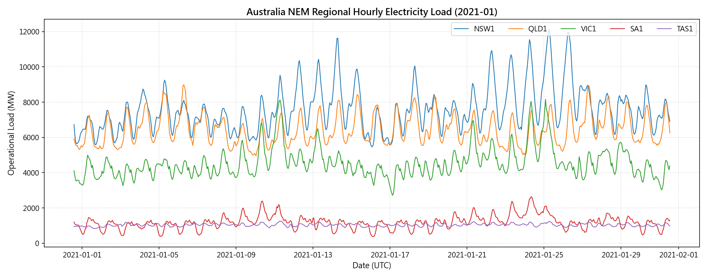
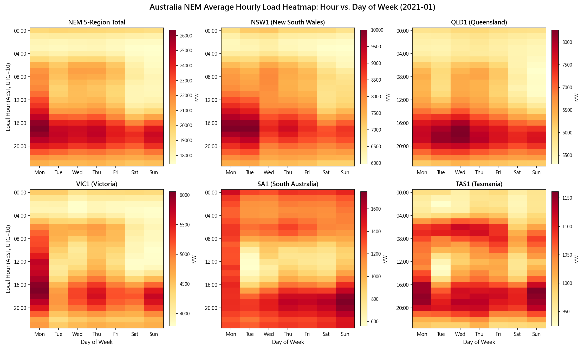

# LoadPulse 澳洲 AEMO 資料品質檢核報告

## 1. 資料來源與定義摘要
- **資料來源**：澳洲國家電力市場調度中心 AEMO (`PRICE_AND_DEMAND`，涵蓋 `NSW1`、`QLD1`、`SA1`、`TAS1`、`VIC1` 五大調度區)
- **原始檔案**：`data/raw/Australia_AEMO/AU_AEMO_{REGION}_RAW_202101.csv`（保留原始下載狀態，未經覆寫）
- **負載定義**：採用 `TOTALDEMAND` 欄位，代表排程與半排程發電機組總出力扣除跨區聯絡線淨輸出之電網層級 **淨調度負載（Net Operational Load）**，不包含表後屋頂太陽能自發自用電量。
- **單位與聚合方式**：原始資料為 30 分鐘區間平均有功功率（`MW`），時間戳記 `SETTLEMENTDATE` 為區間結束標記（Interval-Ending）；前處理先往前平移 30 分鐘轉為區間起始時間後，取每小時算術平均（`.mean()`）聚合為逐小時負載（`MW`）。
- **時間涵蓋範圍**：當地時間 `2021-01-01T00:00:00+10:00` 至 `2021-01-31T23:00:00+10:00`（對應 UTC 時間 `2020-12-31T14:00:00Z` 至 `2021-01-31T13:00:00Z`，共 31 天、744 小時）。
- **時區與資料表結構**：以 `timestamp_utc` 作為唯一主鍵（Primary Key）橫向整合五大調度區，並保留當地時間 `timestamp_local`（IANA 時區：`Australia/Brisbane`，全年固定 `UTC+10`、無 DST 切換）。
- **輸出檔案**：
  - 標準寬表：`data/processed/AU_AEMO_NEM_hourly_202101.csv`（744 筆，含共用日曆特徵與各州負載／品質旗標）
  - 完整稽核寬表：`data/processed/AU_AEMO_NEM_hourly_202101_full_qc.csv`

---

## 2. 清洗前後筆數與各州品質檢核統計

### 2.1 五大調度區清洗與異常旗標總表

| 調度區 | 清洗前筆數 (30min) | 清洗後筆數 (1h) | 缺失時數 (`is_missing`) | 重複時間 (`is_duplicate`) | DST 切換 (`is_dst_transition`) | 可疑極端值 (`is_suspected_outlier`) |
| :--- | :---: | :---: | :---: | :---: | :---: | :---: |
| **NSW1** (新南威爾斯) | `1,488` | `744` | `0` (`0.00%`) | `0` | `0` | `36` 筆 (`4.84%`) |
| **QLD1** (昆士蘭) | `1,488` | `744` | `0` (`0.00%`) | `0` | `0` | `4` 筆 (`0.54%`) |
| **SA1** (南澳) | `1,488` | `744` | `0` (`0.00%`) | `0` | `0` | `50` 筆 (`6.72%`) |
| **TAS1** (塔斯馬尼亞) | `1,488` | `744` | `0` (`0.00%`) | `0` | `0` | `0` 筆 (`0.00%`) |
| **VIC1** (維多利亞) | `1,488` | `744` | `0` (`0.00%`) | `0` | `0` | `45` 筆 (`6.05%`) |

### 2.2 各州負載數值分佈與統計區間摘要 (MW)

| 調度區 | 最小值 (MW) | 平均值 (MW) | 最大值 (MW) | IQR 正常統計區間 (MW) | 異常值成因判讀 |
| :--- | :---: | :---: | :---: | :---: | :--- |
| **NSW1** | `5,469.45` | `7,570.49` | `12,115.88` | `[4414.4, 10338.6]` | 盛夏熱浪引發午後空調冷氣負載大幅攀升 |
| **QLD1** | `4,955.16` | `6,436.80` | `8,970.12` | `[3836.7, 8916.3]` | 副熱帶氣候負載基數高，波動相對平穩 |
| **SA1** | `380.79` | `1,185.21` | `2,634.60` | `[459.4, 1886.8]` | 屋頂光電滲透率高，正午低谷與傍晚尖峰落差顯著 |
| **TAS1** | `833.70` | `1,034.19` | `1,261.38` | `[788.4, 1273.5]` | 氣候涼爽且工業負載穩定，全月無離群值 |
| **VIC1** | `2,719.52` | `4,540.21` | `8,161.68` | `[2685.0, 6122.6]` | 夏季高溫日用電尖峰明顯高於平日基準 |

---

## 3. 視覺化品質檢核

### 3.1 2021 年 1 月五大調度區逐小時負載曲線
下圖呈現澳洲 NEM 五個調度區於 2021 年 1 月之負載規模對比與多日熱浪尖峰波動：

### 3.2 小時 × 星期幾平均負載熱圖
下圖呈現 NEM 總負載與五大調度區在當地時間（`AEST, UTC+10`）各時段之平均負載分布，可清楚觀察到 `NSW1`、`QLD1` 與 `VIC1` 的午後至傍晚空調尖峰，以及 `SA1` 正午（10:00–15:00）受屋頂太陽能發電影響所形成的淨負載凹陷：

---

## 4. 檢核結論與後續處理策略
1. **極端負載旗標保留原則**：`NSW1`、`VIC1` 與 `SA1` 偵測出之 `OUTLIER` 紀錄皆對應真實氣象熱浪尖峰或太陽光電淨負載低谷，而非量測錯誤。依資料清洗規範，所有數值皆完整保留不做刪除或平滑，僅透過 `*_quality_flag` 標記供後續模型訓練參考。
2. **後續多國擴充**：已完成丹麥（Pilot 基準）與澳洲（主力訓練資料集）之標準化產出與品質檢核，下一步將執行美國聯邦 EIA（`ERCO` 德州次區）清洗管線以完成跨國泛化測試資料集。