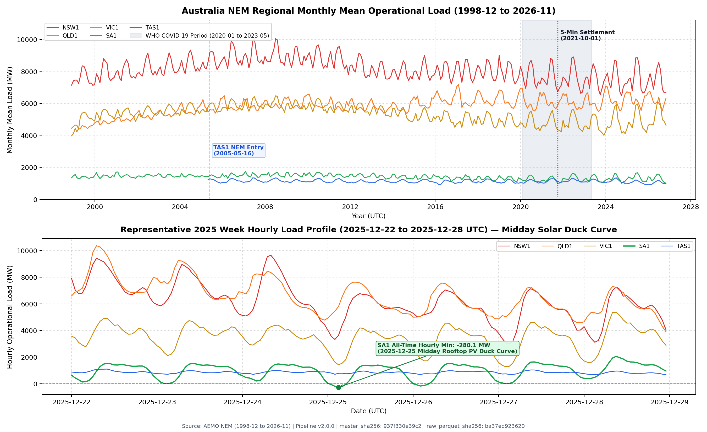
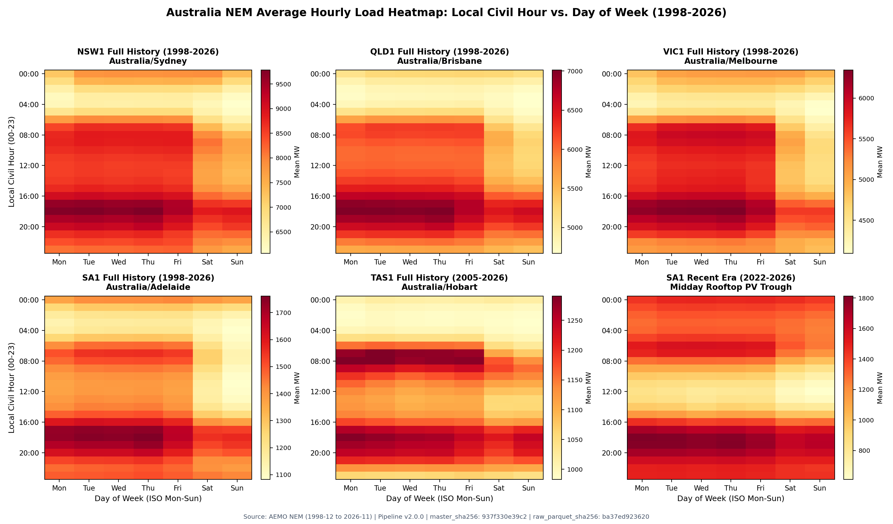
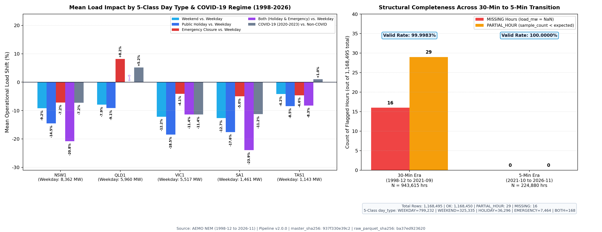
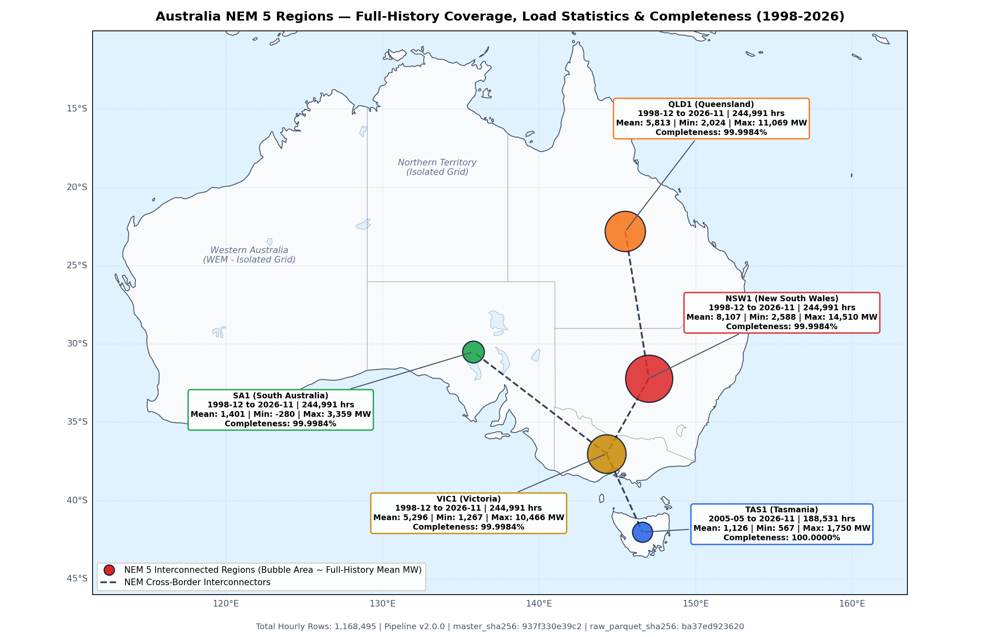

# LoadPulse 澳洲 AEMO NEM 全歷史（1998–2026）資料品質檢核報告

## 1. 資料集總覽與三層 SHA-256 溯源紀錄

### 1.1 資料來源與規格定義
- **資料來源**：澳洲國家電力市場調度中心 AEMO（`PRICE_AND_DEMAND`，涵蓋 `NSW1`、`QLD1`、`SA1`、`TAS1`、`VIC1` 東澳五大互聯調度區；原始 1,603 份月 CSV 經無損打包為 `data/processed/AU_AEMO_NEM_raw_1998_2026.parquet`，共 `4,585,729` 筆原始區間紀錄）。
- **負載口徑**：採用 `TOTALDEMAND`（MW），代表排程與半排程發電機組總出力扣除跨區聯絡線淨輸出之電網層級 **淨調度負載（Net Operational Load）**，不含表後（Behind-the-Meter）屋頂太陽能自發自用電量。本階段輸出不包含 `RRP` 與 `PERIODTYPE` 欄位。
- **表結構與主鍵**：改採全歷史逐小時**長表（Long Format）**，唯一複合主鍵為 `(region_id, timestamp_utc)`，總筆數 **`1,168,495`** 筆（0 重複列），以 `pyarrow` + `ZSTD` 壓縮輸出：
  - **主訓練長表**：`data/processed/AU_AEMO_NEM_hourly_1998_2026.parquet`（**14** 欄、`9.51 MB`）
  - **完整稽核溯源長表**：`data/processed/AU_AEMO_NEM_hourly_1998_2026_full_qc.parquet`（**28** 欄、`10.65 MB`）
- **清洗管線版本與版本標籤**：
  - `PIPELINE_VERSION`：`2.0.0`（`data_pipeline/core_pipeline.py`、`data_pipeline/run_australia_pipeline.py`）
  - 複合版本字串（寫入 `full_qc` 表 `version` 欄）：`v2.0.0+src.937f330e39c2+raw.ba37ed923620`
  - 產出時間（UTC）：`2026-11-23T14:50:42.191602+00:00`

### 1.2 三層 SHA-256 完整溯源紀錄表
管線於啟動前強制比對 `data/processed/raw_bundle_manifest.json`，驗證輸入 Parquet 與外部靜態 CSV 之指紋完全一致後方執行清洗；所有完整 64 碼指紋均同步寫入兩份輸出 `.parquet` 之 Arrow Schema Metadata，且 `full_qc` 表另於每一非缺失列記錄其原始月檔 `source_file` 與 64 碼 `source_file_sha256`。

| 溯源層級 / Metadata 鍵名 | 對象 / 說明 | 完整 64 碼 SHA-256 指紋 |
| :--- | :--- | :--- |
| **`master_sources_sha256`** | 1,605 份源頭檔（1,603 原始 CSV + 2 外部 CSV）依 POSIX 相對路徑排序彙算之頂層總指紋 | `937f330e39c2e2eab5847b3726f8f0c89cc8d89dff052c8358393aae246087a8` |
| **`input_raw_parquet_sha256`** | `data/processed/AU_AEMO_NEM_raw_1998_2026.parquet`（28.74 MB，4,585,729 筆） | `ba37ed923620fc985e791243559acf310ea02f1dab51923aae6929f111e458e7` |
| **`external_holidays_sha256`** | `data/external/au_public_holidays.csv`（1,519 筆） | `e656bf95b3a2c40e77f65e4ccdd5bdd0407c55b0e0f2451b6fc79c261bb58d52` |
| **`external_emergency_sha256`** | `data/external/au_emergency_closures.csv`（322 筆，已修正 `wattclarity.com.au` 網域） | `ece7d3be3fc98f3db8f0fdea5c39e5415cbb234e892cc373ce208be0841c3bca` |
| **主訓練長表輸出 SHA-256** | `data/processed/AU_AEMO_NEM_hourly_1998_2026.parquet`（9.51 MB，14 欄） | `23ae6d18b7c527b095e0f24ded65beeedd23667090ffc66d113fadf9e6062fa9` |
| **完整稽核表輸出 SHA-256** | `data/processed/AU_AEMO_NEM_hourly_1998_2026_full_qc.parquet`（10.65 MB，28 欄） | `2f66252ad48f2dd80c389af314cda366051ee2eb51c1135ca3da6c77cb898bf3` |

---

## 2. 各區時間覆蓋範圍與 30min → 5min 切換驗證

### 2.1 各調度區營運涵蓋期間與邊界說明
本管線依各區實際併入 NEM 之營運起訖建立連續逐小時 UTC 網格，避免為尚未併網之 `TAS1`（1998-12 至 2005-05-15 共 77 個月官方 404）平白補出 `56,460` 筆結構性假缺失：

| 調度區 | 民用 IANA 時區 | 起始時刻 (UTC) | 結束時刻 (UTC) | 原始區間筆數 | 逐小時總列數 | 備註 |
| :--- | :--- | :---: | :---: | :---: | :---: | :--- |
| **NSW1** | `Australia/Sydney` | `1998-12-06 15:00Z` | `2026-11-17 13:00Z` | `939,727` | `244,991` | 首月 `199812` 自 12/07 02:00 AEST 起；末月 `202611` 截斷至 11/18 00:00 AEST |
| **QLD1** | `Australia/Brisbane` | `1998-12-06 15:00Z` | `2026-11-17 13:00Z` | `939,727` | `244,991` | 全年固定 `UTC+10`，無 DST |
| **SA1** | `Australia/Adelaide` | `1998-12-06 15:00Z` | `2026-11-17 13:00Z` | `939,727` | `244,991` | 半小時民用時區（`+09:30` / `+10:30`），UTC 整點對應當地 `HH:30` |
| **TAS1** | `Australia/Hobart` | `2005-05-16 03:00Z` | `2026-11-17 13:00Z` | `826,821` | `188,531` | 2005-05-16 正式併網加入 NEM（1998-12 至 2005-04 為官方 404） |
| **VIC1** | `Australia/Melbourne` | `1998-12-06 15:00Z` | `2026-11-17 13:00Z` | `939,727` | `244,991` | 與 NSW1、QLD1、SA1 同步起訖 |
| **合計** | — | — | — | **`4,585,729`** | **`1,168,495`** | 複合主鍵 `(region_id, timestamp_utc)` 100% 唯一 |

### 2.2 2021-10-01 五分鐘結算制（5MS）切換驗證
AEMO 於市場時間 `2021-10-01 00:00:00 AEST`（對應 `2021-09-30 14:00:00Z`）正式將結算週期由 **30 分鐘**加密為 **5 分鐘**。管線先以 `format="mixed"` 解析全歷史無秒／含秒字串（`0` 筆 `NaT`），再分段平移為區間起點（`dt_end <= 2021-10-01 00:00:00` 減 `30min`、`dt_end > 2021-10-01 00:00:00` 減 `5min`），切換邊界 `2021-09-30 13:30Z` → `2021-09-30 14:00Z` 完全無縫銜接且 `0` 筆重複：

| 結算時期 | 涵蓋期間（市場時間） | 原始間隔 | 每小時預期樣本數 | 逐小時總列數 | `OK` 列數 | `PARTIAL_HOUR` | `MISSING` | 有效資料完整率 |
| :--- | :---: | :---: | :---: | :---: | :---: | :---: | :---: | :---: |
| **30 分鐘時期** | `1998-12` ~ `2021-09` | `30 min` | `2` | `943,615` | `943,570` | `29` | `16` | `99.9983%` |
| **5 分鐘時期** | `2021-10` ~ `2026-11` | `5 min` | `12` | `224,880` | `224,880` | `0` | `0` | **`100.0000%`** |
| **全歷史合計** | `1998-12` ~ `2026-11` | `30 / 5 min` | `2 / 12` | **`1,168,495`** | **`1,168,450`** | **`29`** | **`16`** | **`99.9986%`** |

---

## 3. 結構性完整性稽核表與異常時段明細

本版管線（v2.0.0）**全面停用硬性 MW 上下限（舊版 `100–20,000 MW`）與 `1.5×IQR` 極端值過濾**，避免將真實極端熱浪尖峰或南澳高比例屋頂光電倒灌負值誤判為異常，僅保留結構性缺值（`is_missing`）與每小時實收樣本數（`sample_count < expected_samples` → `is_partial_hour`）檢核，缺值小時忠實保留 `load_mw = NaN` 不插補。

### 3.1 各調度區品質旗標總表

| 調度區 | 總小時數 | `OK` 筆數 | `PARTIAL_HOUR` | `MISSING` | `is_duplicate` | 有效完整率 |
| :--- | :---: | :---: | :---: | :---: | :---: | :---: |
| **NSW1** | `244,991` | `244,980` | `7` | `4` | `0` | `99.9984%` |
| **QLD1** | `244,991` | `244,980` | `7` | `4` | `0` | `99.9984%` |
| **SA1** | `244,991` | `244,980` | `7` | `4` | `0` | `99.9984%` |
| **TAS1** | `188,531` | `188,530` | `1` | `0` | `0` | **`100.0000%`** |
| **VIC1** | `244,991` | `244,980` | `7` | `4` | `0` | `99.9984%` |
| **合計** | **`1,168,495`** | **`1,168,450`** | **`29`** | **`16`** | **`0`** | **`99.9986%`** |

### 3.2 全歷史 16 筆 `MISSING` 與 29 筆 `PARTIAL_HOUR` 發生時段
- **全部 16 筆 `MISSING` 小時（皆發生於 1999–2001 早期 30 分鐘時期，四州同步缺漏，2001-04-08 之後連續逾 25.5 年零缺漏）**：
  - `1999-05-13 04:00Z`（NSW1, QLD1, SA1, VIC1 各 1 小時，共 4 筆）
  - `2000-05-13 01:00Z`（NSW1, QLD1, SA1, VIC1 各 1 小時，共 4 筆）
  - `2001-04-08 13:00Z`、`2001-04-08 14:00Z`（NSW1, QLD1, SA1, VIC1 各連續 2 小時，共 8 筆）
- **全部 29 筆 `PARTIAL_HOUR` 小時（皆為 30 分鐘時期僅實收 `1/2` 筆樣本，5 分鐘時期為 `0` 筆）**：
  - **開市／併網首小時半點起算邊界（5 筆）**：`NSW1`/`QLD1`/`SA1`/`VIC1` 於 `1998-12-06 15:00Z`（自 AEST 01:30 起算）；`TAS1` 於 `2005-05-16 03:00Z`（自 AEST 13:30 併網起算）。
  - **早期 AEMO 單區間缺報（24 筆）**：`NSW1`/`QLD1`/`SA1`/`VIC1` 四州同步於 `1999-05-09 14:00Z`、`1999-05-09 15:00Z`、`1999-05-13 03:00Z`、`1999-06-17 03:00Z`、`2000-03-23 03:00Z`、`2000-08-23 03:00Z` 各缺少半小時紀錄（每時點 4 州 × 6 時點 = 24 筆）。

---

## 4. 負載物理分佈統計與 SA1 屋頂光電倒灌現象

| 調度區 | 平均值 (MW) | 標準差 (MW) | 最小值 (MW) | P05 (MW) | 中位數 (MW) | P95 (MW) | 最大值 (MW) | `<= 0 MW` 小時數 |
| :--- | :---: | :---: | :---: | :---: | :---: | :---: | :---: | :---: |
| **NSW1** | `8,106.79` | `1,392.67` | `2,588.47` | `6,009.79` | `8,058.12` | `10,482.45` | `14,509.95` | `0` |
| **QLD1** | `5,813.10` | `982.00` | `2,023.65` | `4,260.40` | `5,785.94` | `7,465.78` | `11,069.23` | `0` |
| **SA1** | `1,400.82` | `341.70` | **`-280.12`** | `898.12` | `1,392.43` | `1,959.52` | `3,358.57` | **`124`** |
| **TAS1** | `1,126.45` | `152.61` | `567.49` | `909.19` | `1,107.15` | `1,415.55` | `1,750.05` | `0` |
| **VIC1** | `5,295.87` | `965.93` | `1,266.76` | `3,820.91` | `5,238.02` | `6,891.02` | `10,466.43` | `0` |

- **SA1 表後屋頂光電倒灌（負淨負載）現象解析**：
  - 南澳（`SA1`）為全球分散式屋頂太陽能滲透率最高的電力市場之一。於晴朗春夏季正午且遇假日工商業用電偏低時，表後屋頂光電發電量已可超越全州終端用電總量並向主網倒送電能，導致電網淨調度負載 `TOTALDEMAND` 降至負值。
  - 全歷史原始 5 分鐘區間中，`SA1` 共有 `1,581` 筆 `<= 0 MW`（單區間歷史最低達 **`-311.10 MW`**）；聚合為逐小時平均後，共有 **`124` 小時 `<= 0 MW`**，逐時最低點為 **`-280.12 MW`**，發生於當地時間 **`2025-12-25T13:30:00+10:30`**（2025 年聖誕節正午，`2025-12-25 03:00Z`，實收完整 12/12 筆 5 分鐘樣本）。
  - 此實證充分說明為何本版管線移除舊版 `100 MW` 物理下界與 `1.5×IQR` 過濾規則：負值與深凹鴨子曲線正是現代高再生能源滲透電網之關鍵物理特徵，須完整保留供預測模型學習。

---

## 5. 民用時區、夏令時間、五分類 `day_type` 與 COVID-19 統計摘要

### 5.1 嚴格互斥五分類 `day_type` 筆數核對與獨立旗標統計
為避免國定假日與災害緊急停班重疊造成標籤混訊，本版將 `day_type` 升級為**嚴格互斥五分類**，同時完整保留獨立二元旗標（`is_weekend`、`is_public_holiday`、`is_emergency_closure`）：

| `day_type` 類別 | 判定邏輯 | 全歷史總小時數 | 占比 |
| :--- | :--- | :---: | :---: |
| **`WEEKDAY`** | `(is_emergency_closure == 0) & (is_public_holiday == 0) & (is_weekend == 0)` | `799,232` | `68.40%` |
| **`WEEKEND`** | `(is_emergency_closure == 0) & (is_public_holiday == 0) & (is_weekend == 1)` | `325,335` | `27.84%` |
| **`PUBLIC_HOLIDAY`** | `(is_emergency_closure == 0) & (is_public_holiday == 1)` | `36,296` | `3.11%` |
| **`EMERGENCY_CLOSURE`** | `(is_emergency_closure == 1) & (is_public_holiday == 0)` | `7,464` | `0.64%` |
| **`BOTH`** | `(is_emergency_closure == 1) & (is_public_holiday == 1)`（7 州-日） | `168` | `0.01%` |
| **合計** | 嚴格互斥無重疊、無遺漏 | **`1,168,495`** | **`100.00%`** |

### 5.2 各州 DST、獨立事件旗標與 COVID-19 小時統計

| 調度區 | `is_dst = 1` 小時數（占比） | `is_dst_transition` | `is_public_holiday` | `is_emergency_closure` | `BOTH` 重疊小時數（日數） | `is_covid_period` |
| :--- | :---: | :---: | :---: | :---: | :---: | :---: |
| **NSW1** | `116,807` (`47.68%`) | `56` | `7,924` | `840` | `24`（1 日） | `28,609` |
| **QLD1** | `0` (`0.00%`) | `0` | `7,968` | `1,080` | `0`（0 日） | `28,608` |
| **SA1** | `115,295` (`47.06%`) | `56` | `7,873` | `1,368` | `48`（2 日） | `28,609` |
| **TAS1** | `92,806` (`49.23%`) | `43` | `4,800` | `1,872` | `48`（2 日） | `28,609` |
| **VIC1** | `116,807` (`47.68%`) | `56` | `7,899` | `2,472` | `48`（2 日） | `28,609` |
| **合計** | **`441,715`** | **`211`** | **`36,464`** | **`7,632`** | **`168`（7 日）** | **`143,044`** |

- **COVID-19 期間標記說明**：依 WHO 國際關注公共衛生緊急事件期間（`2020-01-30` 至 `2023-05-05`，含端點）標記 `is_covid_period = 1`；無 DST 之 `QLD1` 恰為 `1,192 日 × 24 = 28,608` 小時，實施 DST 之四州因起點位於夏令時間、終點位於標準時間，跨越一次秋季回撥多出 1 小時故為 `28,609` 小時。完整緊急停班與 `BOTH` 案例分析請參閱 [au_emergency_closures_report.md](./au_emergency_closures_report.md)。

### 5.3 各州五分類 `day_type` 與疫情期間平均負載對比（MW）

| 調度區 | `WEEKDAY` (基準) | `WEEKEND` | `PUBLIC_HOLIDAY` | `EMERGENCY_CLOSURE` | `BOTH` | 非疫情 (`is_covid=0`) | 疫情 (`is_covid=1`) |
| :--- | :---: | :---: | :---: | :---: | :---: | :---: | :---: |
| **NSW1** | `8,361.76` | `7,591.17` (`-9.2%`) | `7,146.74` (`-14.5%`) | `7,759.53` (`-7.2%`) | `6,622.82` (`-20.8%`) | `8,175.89` | `7,584.11` (`-7.2%`) |
| **QLD1** | `5,960.29` | `5,487.52` (`-7.9%`) | `5,418.09` (`-9.1%`) | `6,449.08` (`+8.2%`) | `—` (`n=0`) | `5,778.15` | `6,077.45` (`+5.2%`) |
| **SA1** | `1,461.23` | `1,275.98` (`-12.7%`) | `1,203.77` (`-17.6%`) | `1,388.00` (`-5.0%`) | `1,111.80` (`-23.9%`) | `1,419.45` | `1,259.95` (`-11.2%`) |
| **TAS1** | `1,142.93` | `1,094.93` (`-4.2%`) | `1,046.09` (`-8.5%`) | `1,090.06` (`-4.6%`) | `1,048.59` (`-8.3%`) | `1,124.70` | `1,136.22` (`+1.0%`) |
| **VIC1** | `5,517.26` | `4,843.30` (`-12.2%`) | `4,496.60` (`-18.5%`) | `5,289.68` (`-4.1%`) | `4,888.18` (`-11.4%`) | `5,367.30` | `4,755.67` (`-11.4%`) |

> 註：`QLD1` 於 `EMERGENCY_CLOSURE` 日平均負載高於全歷史 `WEEKDAY`（`+8.2%`），主因昆士蘭災害停班多集中於近期高溫濕熱之夏秋氣旋／洪災時期，而全歷史平日基準涵蓋 1998–2005 年較低負載基期；若改以同週期前後 28 天乾淨同星期基準比較，負載變動方向則更精準反映當下災害衝擊（詳見 `au_emergency_closures_report.md`）。

---

## 6. 視覺化品質檢核

### 6.1 全歷史（1998–2026）月均負載演變與 2025 代表週鴨子曲線
上圖呈現五大調度區長達 28 年之月均淨調度負載長期趨勢（標註 `TAS1` 2005-05 併網、WHO 疫情區間與 2021-10 五分鐘結算切換）；下圖聚焦 2025 年 12 月底代表週（`2025-12-22`–`2025-12-28` UTC），清楚可見 `SA1` 於 2025-12-25 聖誕節正午因高比例屋頂太陽能發電使淨負載下探至 `-280.1 MW`：

### 6.2 各州當地民用時間（`local_hour` × `day_of_week`）平均負載熱圖
下圖以各州實際民用 IANA 時區（已反映 DST 與南澳半小時時差）繪製全歷史 24 小時 × 星期一至日平均負載分佈，並於右下角子圖單獨對照 `SA1` 近年（2022–2026）熱圖，凸顯正午（10:00–15:00）屋頂太陽能所造成之深層淨負載低谷與傍晚（18:00–20:00）爬坡尖峰：

### 6.3 五分類 `day_type`／疫情負載影響與 30min → 5min 時期資料完整度對比
左圖比較各州在 `WEEKEND`、`PUBLIC_HOLIDAY`、`EMERGENCY_CLOSURE`、`BOTH`（相對於 `WEEKDAY`）與 COVID-19（相對於非疫情期）之平均負載變動百分比；右圖彙整 30 分鐘時期（`943,615` 小時，有效率 `99.9983%`）與 5 分鐘時期（`224,880` 小時，有效率 `100.0000%`）之 `MISSING`（16）與 `PARTIAL_HOUR`（29）分佈：

### 6.4 澳洲東岸 NEM 五大調度區空間分佈與全歷史統計地圖
下圖呈現 NEM 東南部五大互聯調度區地理位置、跨州輸電聯絡線與各區全歷史營運期間、總小時數、平均／最小／最大負載（MW）與完整率（西澳 WEM 與北領地屬獨立電網未納入 NEM）：

---

## 7. 檢核結論與模型訓練應用建議

1. **極高資料完整度與可重現性**：全歷史 `1,168,495` 筆逐小時長表之有效完整率達 **`99.9986%`**（2001-04-08 以後逾 25.5 年零缺值；5 分鐘時期 `100.0000%` 完整），且透過三層 SHA-256 溯源架構可由單一觀測列直接回溯至對應官方月 CSV。
2. **結構性特徵與物理保真**：完整保留 `SA1` 負淨負載（`124` 小時 `<= 0 MW`）與各州真實民用時區／DST／嚴格互斥五分類 `day_type`／疫情旗標，下游預測模型可依實驗設計自由開關 `is_covid_period`、明確拆解 `WEEKEND` / `PUBLIC_HOLIDAY` / `EMERGENCY_CLOSURE` / `BOTH` 衝擊，並於訓練階段排除 `is_missing == 1` 之 16 筆空白小時。
3. **檔案體積符合版本控制規範**：主訓練長表（`9.51 MB`）與完整稽核長表（`10.65 MB`）均遠低於 GitHub 單檔建議上限，便於團隊直接同步與實驗重現。
