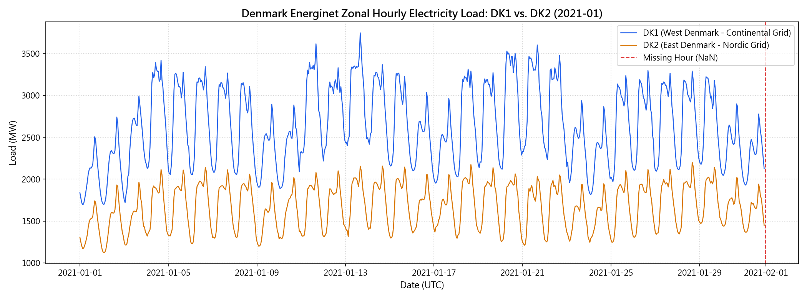
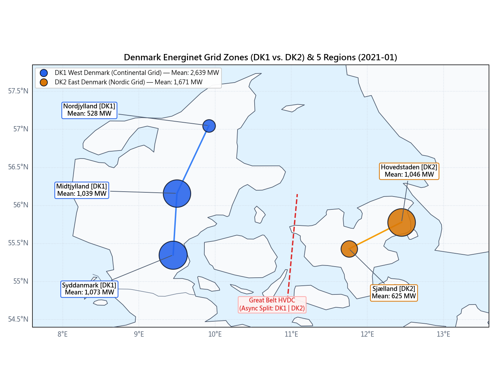

# LoadPulse 丹麥 Energinet 資料品質檢核報告

## 1. 資料來源與定義摘要
- **資料來源**：丹麥輸電系統調度中心 Energinet (`ConsumptionConsumerCategoryHour`)
- **原始檔案**：`data/raw/Denmark_Energinet/DK_ConsumptionCategory_RAW_202101.csv`（共 `11,160` 筆原始明細，保留原始下載狀態，未經覆寫）
- **電網分區與負載定義**：丹麥電網以大貝爾特海峽（Great Belt）為界分為兩個非同步電網區域，本管線依五大行政區（`RegionName`）與三大用戶類別（`ConsumerCategory3`）分別彙總並換算為逐小時平均功率 `load_mw`（原始電能 `kWh` 除以 `1,000`）：
  - **DK1（西丹麥電網）**：涵蓋 `Nordjylland`、`Midtjylland`、`Syddanmark` 三大行政區（`3 區 × 3 用戶類別 = 9 筆/小時`），同步於歐洲大陸電網。
  - **DK2（東丹麥電網）**：涵蓋 `Hovedstaden`、`Sjælland` 二大行政區（`2 區 × 3 用戶類別 = 6 筆/小時`），同步於北歐電網。
- **時間涵蓋範圍**：`2021-01-01T00:00:00Z` 至 `2021-01-31T23:00:00Z`（共 31 天，744 小時）。
- **時區與資料表結構**：以 `timestamp_utc` 作為唯一主鍵（Primary Key）橫向整合 `DK1` 與 `DK2`，並保留當地時間 `timestamp_local`（IANA 時區：`Europe/Copenhagen`）。
- **輸出檔案**：
  - 標準寬表：`data/processed/DK_Energinet_hourly_202101.csv`（744 筆，含共用日曆特徵與 `DK1` / `DK2` 負載及品質旗標）
  - 完整稽核寬表：`data/processed/DK_Energinet_hourly_202101_full_qc.csv`

---

## 2. 清洗前後筆數與分區品質檢核統計

### 2.1 DK1 與 DK2 電網分區清洗與異常旗標總表

| 電網分區 | 涵蓋行政區 | 清洗前筆數 | 清洗後筆數 (1h) | 缺失時數 (`is_missing`) | 重複時間 (`is_duplicate`) | DST 切換 (`is_dst_transition`) | 可疑極端值 (`is_suspected_outlier`) |
| :--- | :--- | :---: | :---: | :---: | :---: | :---: | :---: |
| **DK1** (西丹麥) | Nordjylland, Midtjylland, Syddanmark | `6,696` | `744` | `1` (`0.13%`) | `0` | `0` | `0` 筆 (`0.00%`) |
| **DK2** (東丹麥) | Hovedstaden, Sjælland | `4,464` | `744` | `1` (`0.13%`) | `0` | `0` | `0` 筆 (`0.00%`) |

### 2.2 各電網分區負載數值分佈與統計區間摘要 (MW)

| 電網分區 | 最小值 (MW) | 平均值 (MW) | 最大值 (MW) | IQR 正常統計區間 (MW) | 負載特徵與異常判讀 |
| :--- | :---: | :---: | :---: | :---: | :--- |
| **DK1** (西丹麥) | `1,696.21` | `2,639.96` | `3,746.64` | `[1010.1, 4331.2]` | 涵蓋日德蘭半島工業與農業區，基載較高，全月無離群值 |
| **DK2** (東丹麥) | `1,123.38` | `1,671.56` | `2,202.20` | `[727.6, 2615.1]` | 涵蓋哥本哈根都會區，日夜與平日週末節律鮮明，全月無離群值 |

### 2.3 可疑極端值（Outlier）判定規則與物理保留原則
1. **雙重判定規則（`core_pipeline.py`）**：
   - **物理合理硬邊界**：設定單區有效範圍為 `200.0 MW` 至 `10,000.0 MW`，用以排除負值、全網歸零斷電或儀器量測突波。
   - **統計四分位距法（1.5 × IQR 法則）**：計算當期負載分布之第 25 百分位數（$Q_1$）與第 75 百分位數（$Q_3$），令 $\text{IQR} = Q_3 - Q_1$，定義統計合理區間為 $[\max(200,\; Q_1 - 1.5 \times \text{IQR}),\; \min(10000,\; Q_3 + 1.5 \times \text{IQR})]$（標準常態分布下約涵蓋 99.3% 之觀測值）。
2. **缺失與極端值處理原則**：`2021-01` 末尾因 API 依當地時間 `UTC+1` 截取月份邊界，使兩區各有 1 筆 `NaN` 缺值；依規範保留空值不填 `0` 並標記 `MISSING`，供下游建模組決定線性插值或遮罩（Masking）處理。

---

## 3. 視覺化品質檢核

### 3.1 2021 年 1 月 DK1 與 DK2 逐小時負載對比曲線
下圖呈現丹麥兩大非同步電網分區於 2021 年 1 月之週期性波動（工作日高、週末低），紅色虛線標示出唯一一筆 `MISSING` 缺值位置：

### 3.2 小時 × 星期幾平均負載熱圖
下圖顯示丹麥全國總負載、`DK1` 與 `DK2` 在當地時間（`Europe/Copenhagen`）各時段之平均負載分布，可見平日（Mon–Fri）08:00 至 20:00 為主要冬季取暖與商業用電高峰，週末（Sat–Sun）整體負載明顯下降：

### 3.3 電網同步分區與空間地理位置分布
下圖標示丹麥五大行政區之相對地理位置、2021 年 1 月平均負載規模，以及大貝爾特海峽（Great Belt）HVDC 海底電纜所分隔之 `DK1` 與 `DK2` 邊界：

---

## 4. 檢核結論與三國管線整合總結
1. **丹麥分區架構對齊**：已將丹麥由單一全國加總重構為 `DK1` 與 `DK2` 雙區寬表（`DK_Energinet_hourly_202101.csv`），完整反映歐洲大陸電網與北歐電網之物理邊界。
2. **三國資料工程全面到位**：至此已完成 **丹麥 Energinet（`DK1`/`DK2`）**、**澳洲 AEMO（NEM 五大調度區）** 與 **美國聯邦 EIA（八大調度區）** 之統一寬表產出、品質檢核與空間視覺化報告。