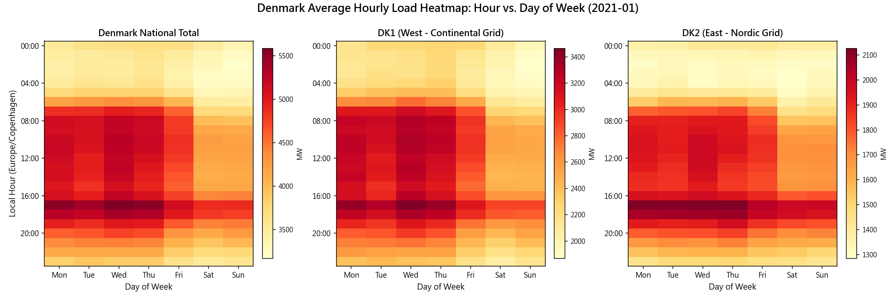

# LoadPulse 資料品質檢核報告

## 1. 資料來源與定義摘要
- **資料來源**：丹麥輸電系統調度中心 Energinet (`ConsumptionConsumerCategoryHour`)
- **原始檔案**：`data/raw/Denmark_Energinet/DK_ConsumptionCategory_RAW_202101.csv`（保留原始下載狀態，未經覆寫）
- **負載定義**：彙總丹麥全國五大區域（`RegionName`）與全用戶類別（`ConsumerCategory3`）之終端用電量，並由原始電能單位 `kWh` 除以 `1,000` 換算為逐小時平均功率 `load_mw`（單位：MW）。
- **時間涵蓋範圍**：`2021-01-01T00:00:00Z` 至 `2021-01-31T23:00:00Z`（共 31 天，744 小時）。
- **時區配置**：以 `UTC` 建立唯一連續時間軸（`timestamp_utc`），並保留當地時間 `timestamp_local`（IANA 時區：`Europe/Copenhagen`）。

---

## 2. 清洗前後筆數與品質檢核統計

| 檢核項目 | 統計結果 | 處理方式與備註 |
| :--- | :--- | :--- |
| **清洗前原始明細筆數** | `11,160` 筆 | 包含 `744 小時 × 5 大區 × 3 用戶類別` |
| **清洗後逐時標準筆數** | `744` 筆 | 完整對齊 2021 年 1 月逐小時 UTC 網格 |
| **缺失小時數 (`is_missing`)** | `1` 筆 (`0.13%`) | 該時段原始電量為 `NaN`；依規範保留空值不填 `0`，標記 `MISSING` |
| **重複時間戳記 (`is_duplicate`)** | `0` 筆 (`0.00%`) | 以 UTC 時間軸驗證無重複紀錄 |
| **DST 切換時數 (`is_dst_transition`)** | `0` 筆 | 1 月份處於歐洲冬令時間（`UTC+1`），無夏令時間切換 |
| **可疑極端值 (`is_suspected_outlier`)** | `0` 筆 | 全月負載皆落於統計合理區間 `[1702.1, 6968.4] MW` 內 |
| **人工插補筆數 (`is_imputed`)** | `0` 筆 | Pilot 階段維持原始觀測真實性，未執行插補 |

### 2.1 負載數值分佈摘要 (MW)
- **最小值**：`2,821.93 MW`
- **平均值**：`4,311.51 MW`
- **最大值**：`5,900.83 MW`

### 2.2 可疑極端值（Outlier）判定規則
本管線（`core_pipeline.py`）採用雙重檢核機制識別異常數值，觸發任一條件即標記 `is_suspected_outlier = 1`：
1. **物理合理硬邊界（Hard Bounds）**：過濾違反電力系統物理常識之數值（如負值、全網歸零斷電或感測器量測突波）。
2. **統計四分位距法（1.5 × IQR 法則）**：計算當期負載分布之第 25 百分位數（$Q_1$）與第 75 百分位數（$Q_3$），令 $\text{IQR} = Q_3 - Q_1$，定義統計合理區間為 $[Q_1 - 1.5 \times \text{IQR},\; Q_3 + 1.5 \times \text{IQR}]$（標準常態分布下約涵蓋 99.3% 之觀測值）。
3. **只標記、不刪除原則**：為避免誤刪真實氣候引發之尖離峰波動，所有觸發旗標之觀測值皆完整保留原數值，僅透過 `quality_flag` 供下游模型識別。

---

## 3. 視覺化品質檢核

### 3.1 2021 年 1 月逐小時負載曲線
下圖呈現全月負載之週期性波動（呈現工作日高、週末低的雙峰日夜節律），紅色虛線標示出唯一一筆 `MISSING` 缺值位置：

### 3.2 小時 × 星期幾平均負載熱圖
下圖顯示當地時間（`Europe/Copenhagen`）各時段之平均負載分佈，可見平日（Mon–Fri）08:00 至 20:00 為主要用電高峰，週末（Sat–Sun）整體負載明顯下降：

---

## 4. 尚未解決問題與後續規劃
1. **單一缺失小時處理策略**：`2021-01` 存在 1 筆 `MISSING` 紀錄，目前已保留 `NaN` 並透過 `quality_flag` 標記，後續將交由建模組決定採用線性插值或遮罩（Masking）處理（因 API 預設依當地時間 `UTC+1` 截取月份邊界所致）。
2. **多國資料源擴充**：已完成通用核心管線（`core_pipeline.py`）之標準函式驗證，並接續完成 **澳洲 AEMO（NEM 五大調度區）** 寬表整合，後續將接入 **美國 EIA（`ERCO` 德州次區）** 資料源以完成跨國泛化驗證集。