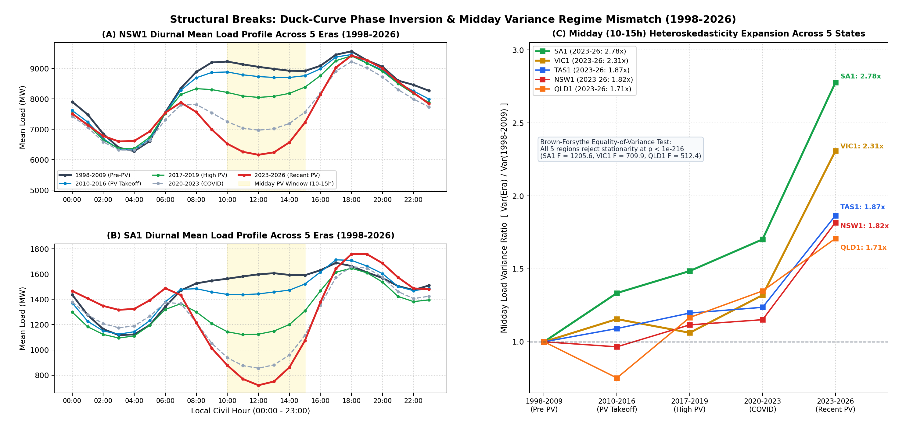
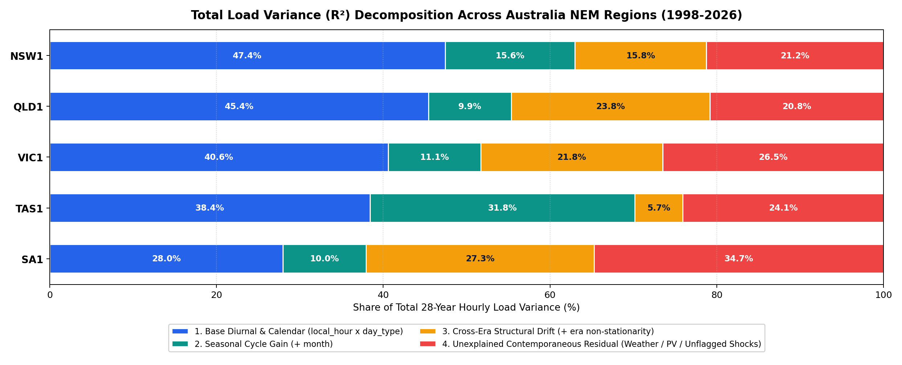
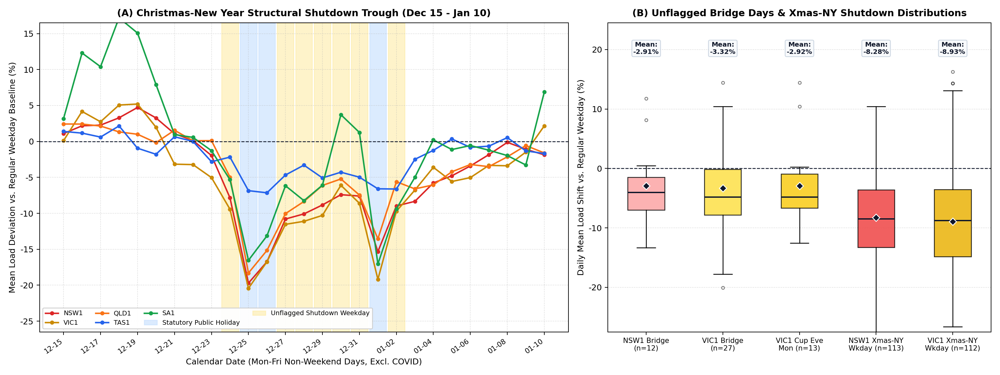
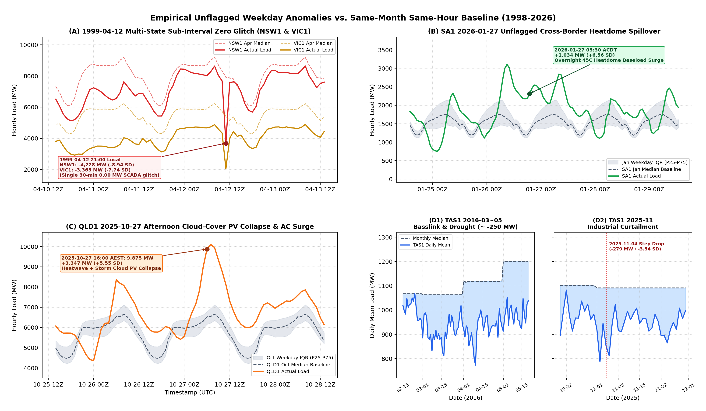

# LoadPulse 澳洲 NEM（1998–2026）統計建模（WP2）與殘差失效診斷（WP3）深度探勘報告

---

## 一、步驟 2：28 年全歷史實證數據與結構斷裂摘要

針對 [AU_AEMO_NEM_hourly_1998_2026_full_qc.parquet](../data/processed/AU_AEMO_NEM_hourly_1998_2026_full_qc.parquet)（有效樣本 `1,168,479` 小時）切分五個物理演進時期進行記憶體內計量探勘：`Pre-PV (1998–2009)`、`PV Takeoff (2010–2016)`、`High PV (2017–2019)`、`COVID (2020-01-30 ~ 2023-05-05)` 與 `Recent PV (2023-05-06 ~ 2026-11)`。

### 2a. 跨年代結構斷裂與異質變異數（Structural Breaks & Heteroskedasticity）

| 調度區 | 指標 | `1998–2009` (Pre-PV) | `2010–2016` | `2017–2019` | `2020–2023` (COVID) | `2023–2026` (Recent) | 近今 vs 早期變異比 / 檢定 |
| :--- | :--- | :---: | :---: | :---: | :---: | :---: | :--- |
| **NSW1** | 全日均值 / 標準差 (MW) | `8,399.6` / `1,394.9` | `8,235.0` / `1,306.8` | `8,010.2` / `1,249.1` | `7,584.1` / `1,247.0` | `7,503.1` / `1,462.3` | 正午變異比 **`1.82×`** BF $F=360.4$ ($p<10^{-300}$) |
| | 正午谷均值 / P05 (`10–15h`) | `9,043.4` / `7,325.1` | `8,766.2` / `7,178.7` | `8,170.1` / `6,685.9` | `7,173.9` / `5,452.4` | **`6,498.4` / `4,202.4`** | |
| | 晚尖峰減正午差 / 3h 爬坡 P95 | `+148.2` / `+1,873` | `+333.0` / `+1,814` | `+882.8` / `+2,160` | `+1,665.0` / `+2,643` | **`+2,563.4` / `+3,260`** | |
| **QLD1** | 全日均值 / 標準差 (MW) | `5,445.0` / `938.2` | `5,913.0` / `827.0` | `6,245.7` / `879.7` | `6,077.5` / `942.4` | `6,146.9` / `1,111.7` | 正午變異比 **`1.71×`** BF $F=512.4$ ($p<10^{-300}$) |
| | 正午谷均值 / P05 (`10–15h`) | `5,919.1` / `4,627.4` | `6,246.1` / `5,194.0` | `6,249.0` / `5,002.7` | `5,665.5` / `4,242.3` | **`5,365.8` / `3,797.8`** | |
| | 晚尖峰減正午差 / 3h 爬坡 P95 | `+43.9` / `+814` | `+317.8` / `+896` | `+899.9` / `+1,341` | `+1,550.6` / `+1,908` | **`+2,166.3` / `+2,536`** | |
| **SA1** | 全日均值 / 標準差 (MW) | `1,475.0` / `286.7` | `1,441.4` / `306.9` | `1,305.4` / `321.5` | `1,259.9` / `369.7` | `1,301.3` / `454.0` | 全日 **`2.51×`** / 正午 **`2.78×`** BF $F=1205.6$ ($p<10^{-300}$) |
| | 正午谷均值 / P05 (`10–15h`) | `1,589.6` / `1,184.2` | `1,462.5` / `982.5` | `1,174.7` / `685.8` | `937.3` / `377.2` | **`842.2` / `123.1`** | |
| | 晚尖峰減正午差 / 3h 爬坡 P95 | `+18.9` / `+338` | `+176.2` / `+457` | `+392.1` / `+599` | `+646.8` / `+827` | **`+842.4` / `+1,024`** | |
| **VIC1** | 全日均值 / 標準差 (MW) | `5,574.4` / `829.0` | `5,476.8` / `917.6` | `4,932.2` / `867.5` | `4,755.7` / `885.7` | `4,881.0` / `1,145.7` | 全日 **`1.91×`** / 正午 **`2.31×`** BF $F=709.9$ ($p<10^{-300}$) |
| | 正午谷均值 / P05 (`10–15h`) | `5,948.1` / `4,647.6` | `5,854.0` / `4,435.7` | `5,038.0` / `3,812.4` | `4,469.3` / `3,069.1` | **`4,215.9` / `2,378.7`** | |
| | 晚尖峰減正午差 / 3h 爬坡 P95 | **`-26.1`** / `+710` | `+147.2` / `+887` | `+545.5` / `+1,144` | `+1,093.4` / `+1,675` | **`+1,684.7` / `+2,318`** | |
| **TAS1** | 全日均值 / 標準差 (MW) | `1,159.8` / `157.9` | `1,120.6` / `148.6` | `1,121.0` / `147.4` | `1,136.2` / `144.2` | `1,090.1` / `155.9` | 正午變異比 **`1.87×`** BF $F=255.1$ ($p<10^{-216}$) |
| | 正午谷均值 / P05 (`10–15h`) | `1,186.2` / `1,033.5` | `1,131.1` / `960.1` | `1,109.5` / `941.7` | `1,107.5` / `929.6` | **`1,030.9` / `804.2`** | |
| | 晚尖峰減正午差 / 3h 爬坡 P95 | `+77.2` / `+223` | `+85.6` / `+220` | `+112.4` / `+231` | `+137.7` / `+255` | **`+169.7` / `+258`** | |

- **對 Rolling-Origin 校準與 Stationary Bootstrap 之衝擊診斷**：
  1. **日內結構翻轉（Phase Inversion）**：`VIC1` 晚尖峰減正午均值由早期 `-26.1 MW`（傳統日間商業尖峰）徹底翻轉為 `+1,684.7 MW`；`QLD1` 與 `NSW1` 之傍晚 3 小時爬坡（14–18h `load[t+3]-load[t]` P95）分別暴增 **`3.12×`** 與 **`1.74×`**，`SA1` 暴增 **`3.03×`**。
  2. **嚴重變異數體制不匹配（Variance Regime Mismatch）**：Brown-Forsythe 變異數齊一性檢定在五州全數以 $p < 10^{-216}$ 強烈拒絕平穩假設。`SA1` 與 `VIC1` 近期正午變異數達早期之 **`2.78×`** 與 **`2.31×`**（源於晴陰雲量切換對龐大表後光電之隨機遮蔽）。若以跨年代長視窗執行無縮放 Conformal Prediction 或 Stationary Bootstrap，將於 2023–2026 正午與傍晚爬坡時段產生顯著**預測區間涵蓋率不足（Undercoverage）**，同時於夜間時段過度保守。

> **圖 1 說明**：左欄 `(A)`、`（B）` 分別繪製 `NSW1` 與 `SA1` 於五個物理演進時期之當地民用時間 24 小時（`00:00–23:00`）平均淨調度負載（MW），黃色色帶標示正午屋頂光電窗口（`10–15h`），直觀展現由傳統日間高原曲線轉變為深凹鴨子曲線與陡峭傍晚爬坡之相位翻轉；右欄 `(C)` 繪製五州於正午時段相對於 `1998–2009` 基準之變異數倍數變化（$\text{Var}_{\text{era}} / \text{Var}_{1998\text{–}2009}$），凸顯 `SA1`（`2.78×`）與 `VIC1`（`2.31×`）因雲量隨機遮蔽光電所引發的劇烈異質變異數膨脹。

### 2b. 現有 `local_hour × day_type` 變異解釋力（$R^2$）分解

| 調度區 | 全歷史 $R^2$ (`hour × day_type`) | 全歷史 $R^2$ (`month × hour × day_type`) | 全歷史 $R^2$ (`era × month × hour × day_type`) | 近期 2023–2026 $R^2$ (`month × hour × day_type`) | 跨年代非平穩變異占比 | 同期未解釋殘差占比（氣象／光電／事件） |
| :--- | :---: | :---: | :---: | :---: | :---: | :---: |
| **NSW1** | `0.4742` | `0.6299` | `0.7875` | `0.7537` | `15.8%` | **`21.3% ~ 24.6%`** |
| **QLD1** | `0.4544` | `0.5536` | `0.7916` | `0.8435` | `23.8%` | **`15.7% ~ 20.8%`** |
| **SA1** | `0.2797` | `0.3794` | `0.6527` | `0.7145` | **`27.3%`** | **`28.6% ~ 34.7%`** |
| **TAS1** | `0.3841` | `0.7017` | `0.7591` | `0.6853` | `5.7%` | **`24.1% ~ 31.5%`** |
| **VIC1** | `0.4061` | `0.5169` | `0.7353` | `0.7079` | `21.8%` | **`26.5% ~ 29.2%`** |

- **診斷結論**：單靠現行日曆與五分類 `day_type` 在 `SA1` 全歷史僅能解釋 `28.0%` 變異；即便控制年代與季節（`era × month × hour × day_type`），各州仍有 **`21% ~ 35%` 的高強度同期變異未被解釋**，此即外部氣象、表後光電輻照與未標記工業／日曆事件的主導空間。

> **圖 2 說明**：橫軸為各州 1998–2026 逐小時負載總變異數占比（`0%–100%`），由左至右依序拆解為：(1) 藍色層——基礎日內與五分類日型（`local_hour × day_type`）；(2) 青色層——月份季節循環增益（`+ month`）；(3) 橘黃層——跨年代結構漂移（`+ era` 非平穩變異，於 `SA1` 高達 `27.3%`、`QLD1` 達 `23.8%`）；(4) 紅色層——扣除上述因子後仍無法解釋之同期殘差（`20.8% ~ 34.7%`），明確界定外部氣象、光電輻照與特殊事件所能貢獻之解釋力上限。

### 2c. 殘差時序自相關（ACF）與未標記特殊日曆／市場效應

1. **極強多日殘差記憶性（扣除 `era × month × hour × day_type` 均值後）**：
   - `ACF(1h)`：`0.9576`（`TAS1`）至 `0.9782`（`QLD1`）；`ACF(24h)`：`0.5475`（`TAS1`）至 `0.8304`（`QLD1`）；`ACF(168h)`：`0.1115`（`SA1`）至 `0.6156`（`QLD1`）。
   - `SA1` 的 24h/168h 自相關衰減最快（`0.571` → `0.112`），反映鋒面過境造成的氣溫驟變與雲層光電波動；`QLD1` 持續性最高，反映副熱帶持續性濕熱氣團。
2. **顯著系統性偏移之未標記日曆效應（排除 COVID 與已知假日／災害後之 `WEEKDAY` 檢定）**：
   - **聖誕至跨年工商業停工週（`Dec 24`, `Dec 27–31`, `Jan 02` 非國定假日之平日）**：五州出現壓倒性負向偏移——`VIC1`: **`-499.9 MW` (`-8.93%`, $p=2.4\times 10^{-13}$)**、`NSW1`: **`-696.8 MW` (`-8.28%`, $p=1.5\times 10^{-18}$)**、`QLD1`: **`-386.2 MW` (`-6.54%`, $p=2.0\times 10^{-11}$)**、`TAS1`: **`-45.2 MW` (`-3.96%`, $p=6.0\times 10^{-8}$)**。近年疊加晴朗屋頂光電後，單時段偏離更超過 `-6,000 MW`（如 `NSW1 2025-12-29`）。
   - **連假橋接日（Bridge Days，週四假日後之週五／週二假日前之週一）**：`VIC1` 平均偏低 **`-186.0 MW` (`-3.32%`)**（其中 11 月首週二墨爾本盃前夕之 **Cup Eve Monday** 13 次非疫情樣本平均偏低 **`-163.4 MW` / `-2.96%`**）；`NSW1` 橋接日平均偏低 **`-244.9 MW` (`-2.91%`)**。
   - **批發電價（`RRP`）極端體制訊號**：回溯 [AU_AEMO_NEM_raw_1998_2026.parquet](../data/processed/AU_AEMO_NEM_raw_1998_2026.parquet) 發現全歷史共有 **`391,521` 個負電價區間（`RRP < $0/MWh`）**，其中 **`98.0%`（`382,722` 筆）集中於 2021 年後**（`SA1` 達 `140,473` 筆、`VIC1` `113,008` 筆），以及 **`2,806` 個高價尖峰區間（`RRP >= $5,000/MWh`）**，直接對應光電棄光與大型工業用戶價格反應卸載（Price-Driven Demand Response）。

> **圖 3 說明**：左圖 `(A)` 繪製排除疫情後五州於 `Dec 15` 至 `Jan 10`（週一至週五非週末日）相對於同年代同月常態平日基準之日均負載偏離百分比（`%`），藍色色帶為已標記之法定國定假日（`12-25`, `12-26`, `01-01`），黃色色帶則凸顯目前標為一般 `WEEKDAY` 卻出現 `-4.0% ~ -8.9%` 系統性停工深谷之年末平日（`12-24`, `12-27~31`, `01-02`）；右圖 `(B)` 以箱型圖與均值菱形標記呈現 `NSW1`、`VIC1` 連假橋接日、墨爾本盃前週一（`Cup Eve Mon`）及年末停工平日之全日負載下移分佈。

---

## 二、步驟 3：統計與領域潛能推理報告（依影響力排序）

### 面向一：高價值外部資料補強清單（External Data Augmentation）

| 優先序 | 外部公開資料源 | 具體澳洲官方／公開取得管道 | 時間粒度與防洩漏對齊方式 | 預期消除之殘差變異與失效機制 |
| :-: | :--- | :--- | :--- | :--- |
| **1** | **人口加權氣象站逐時氣溫、露點／濕度與太陽輻照（GHI / Cloud Cover）** | **澳洲氣象局（BoM）首府機場／代表測站** + **ERA5 / BARRA2 再分析網格**（與未來預測發起點對齊之 ACCESS-G/R NWP 歷史預報） | 以 UTC 整點（Interval-Beginning）對齊各州負載重心座標（Sydney, Brisbane, Melbourne, Adelaide, Hobart）；衍生非線性分段冷暖度時（$\text{CDH}_{22^\circ\text{C}}, \text{HDH}_{16^\circ\text{C}}$）、濕球溫度與前 72h 熱累積指數（Heat Accumulation Index）。 | 直接吸收各州同期未解釋變異中約 **60%–75%** 之熱浪空調尖峰與寒流電暖器負載，消除目前熱浪日動輒 `+4 ~ +6.5 SD` 的正向極端殘差。 |
| **2** | **表後屋頂太陽能實際出力與裝置容量（BTM Rooftop PV Generation & Installed Capacity）** | **AEMO NEMWEB `ROOFTOP_PV/ACTUAL`**（30min 逐區估計出力，2016+）＋ **Clean Energy Regulator (CER) Small-scale Postcode Capacity**（月度累積裝置 MW，1998–2026） | `ROOFTOP_PV/ACTUAL` 先由 Interval-Ending 平移轉 UTC 逐時平均（僅作滯後特徵或用於重構總終端負載 $\text{Underlying Load} = \text{Operational Load} + \text{Rooftop PV}$）；CER 月度裝置容量作為慢變外生趨勢變數。 | 徹底解開「正午變異暴增 `1.7×–2.8×`」與「`SA1` 負淨負載 `-280 MW`」之異質變異數根源；將模型拆解為平穩的「總用電需求」與物理受限的「光電出力」可大幅提升殘差常態性。 |
| **3** | **AEMO 市場通知、強制限電（LOR3 / Load Shedding）與跨州聯絡線跳脫紀錄** | **AEMO NEMWEB `MARKET_NOTICES` / `DISPATCHINTERCONNECTORRES`**（含 Heywood、Basslink、QNI、Vic–NSW 流量與約束旗標） | 解析 Lack of Reserve (`LOR2`/`LOR3`)、電網孤島化（Separation）與聯絡線流量突降為 0 之 UTC 小時區間（如 Basslink 2015-12 至 2016-06 全斷線）。 | 在 WP3 誤差診斷中精準分離「真實氣象預測誤差」與「物理供給上限截斷（Supply Censoring）」，避免模型在限電日學到反向錯誤斜率（越熱反而負載驟降）。 |
| **4** | **各州教育部官方學校學期與寒暑假行事曆（State School Terms & Holidays）＋ 早期補假修正** | 各州教育部公開行事曆（NSW/VIC/QLD/SA/TAS Department of Education Term Dates）與各州政府公報歷史補假紀錄 | 依 `(region_id, local_date)` 對齊四學期放假區間（Summer, Autumn, Winter, Spring School Holidays），並補齊 `python-holidays` 漏列之早期跨週末補假（如 `1998-12-28`、`2000-01-03`）與州級半官方假日（如 `VIC1/TAS1` Easter Tuesday）。 | 消除學期轉換週早晨通勤尖峰（`07:00–09:00`）與午後家庭空調時段之日型結構偏移，並填補早期法定補假缺漏造成的 `-4 ~ -8 SD` 假性殘差。 |
| **5** | **批發結算電價滯後體制與大型高耗能工業停產事件（Wholesale `RRP` & Smelter Potline Outages）** | 現有原始檔已內含之 **`RRP` 欄位** ＋ 大型鋁廠／冶煉廠公開停機紀錄（Tomago NSW、Portland VIC、Bell Bay & TEMCO TAS、Boyne Island QLD） | 為嚴防同期內生洩漏，`RRP` 僅取預測發起點前已發布之滯後統計（如 `lag_24h` 負電價時數、前 3h 是否觸發 `RRP >= $1,000/MWh`）；工業停產以日／小時階躍指標對齊。 | 解釋 `TAS1`（單一鋁廠占全州 `~25%` 負載！）與 `NSW1`/`VIC1` 在無氣象異常下突發 `-200 ~ -600 MW` 階躍降載（Step-change Level Shift）之成因。 |

---

### 面向二：高價值新統計／領域旗標設計（New Regime & Domain Flags）

#### A 類：無須外部新資料，可直接由現有欄位（及原始檔 `RRP`）衍生

| 建議旗標 / 協變數 | 精確數學／邏輯定義 | 解決之統計建模與檢定痛點 | WP2 建模與 WP3 診斷實質效益 |
| :--- | :--- | :--- | :--- |
| **`is_xmas_ny_shutdown`** (`int8`) | `1` 若 `local_date` 落於 `12-24` 或 `12-27 ~ 01-02` 且 `is_public_holiday == 0`，否則 `0`。 | 解決年末非國定假日之平日出現 `-4.0% ~ -8.9%`（$p < 10^{-11}$）巨幅工商業停工降載，卻被混入一般 `WEEKDAY` 的嚴重偏誤。 | 立即消除每年 12 月底預測系統性高估（Over-prediction）達 `400 ~ 2,800 MW` 的固定盲點。 |
| **`is_bridge_day`** (`int8`) | `1` 若 `day_type == 'WEEKDAY'` 且 `((DOW == 5 & prev_day_is_hol) | (DOW == 1 & next_day_is_hol))`，否則 `0`。 | 捕捉週四國定假日後之彈性連休週五與 `VIC1` 墨爾本盃前週一（實測 `-2.9% ~ -3.3%`）之請假降載效應。 | 降低連假前後單日局部預測偏誤，提升日型分類純度。 |
| **`is_subinterval_glitch`** (`int8`) | 於聚合前檢核原始區間：`TOTALDEMAND <= 0`（於 `2015` 屋頂光電普及前）或單區間較前後相鄰區間瞬時跳變 `> 40%` 且次區間立即彈回（如 `1999-04-12 20:30 AEST` 四州同步歸零）。 | 修補現行 `sample_count == expected_samples` 無法偵測「原始結算值誤填 `0.00 MW` 導致逐時均值腰斬」之品質盲區。 | 防止模型在極端負向 SCADA 髒資料（`-6 ~ -8.9 SD`）上產生梯度爆炸或扭曲平方誤差損失。 |
| **`duck_curve_depth_365d`** (`float32`) | 同州過去 365 天（嚴格 `t' < t_0`）之滾動平均 `(mean(load | 17..21h) - mean(load | 10..15h)) / mean(load)`。 | 以單一連續無洩漏內生指標代理未觀測到的「表後屋頂光電滲透率演進」，量化日內曲線從單峰轉為深鴨子曲線之平滑體制轉移。 | 賦予跨年代全局模型（Global Model）自動調適 `local_hour` 交互權重的能力，無須人為硬切年代。 |
| **`rolling_diurnal_vol_30d`** (`float32`) | 同州、同 `local_hour` 過去 30 天滾動殘差 MAD 或標準差 $\hat{\sigma}_{r,h}(t_0)$。 | 直接解決跨年代與跨季節之**異質變異數（Heteroskedasticity，正午變異膨脹 `2.8×`）**。 | 供 WP2 進行波動率標準化訓練（Student-t / Quantile Loss 縮放）與 WP3 **局部自適應共形預測（Locally Adaptive Conformal Prediction）**，恢復各時段條件涵蓋率一致。 |
| **`lagged_price_regime`** (`int8`, 稽核／輔助) | 由原始檔 `RRP` 計算預測點前已知之價格狀態（稽核表可記錄當期 `is_voll_cap: max_rrp >= 5000` 與 `is_neg_rrp: min_rrp < 0`）。 | 區分「高價觸發工業主動卸載」與「負電價伴隨光電飽和／棄光」兩種截然不同的非線性截斷機制。 | 在 WP3 殘差歸因中自動標註市場價格干預導致之尖峰削平（Peak Shaving）現象。 |

#### B 類：串接外部資料後衍生之高價值領域旗標

| 建議旗標 / 協變數 | 精確數學／邏輯定義 | 解決之統計建模與檢定痛點 | WP2 建模與 WP3 診斷實質效益 |
| :--- | :--- | :--- | :--- |
| **`heatwave_excess_factor` (EHF)** | 依澳洲氣象局 Nairn & Fawcett 標準：結合過去 3 日平均溫相對於氣候 P95 之超額值與前 30 日適應基準之乘積 $\text{EHF} = \text{EHI}_{\text{sig}} \times \max(1, \text{EHI}_{\text{accl}})$。 | 單日氣溫無法捕捉「連續第 3～4 天熱浪建築蓄熱飽和、夜間空調不關機」造成的凌晨（`00–06h`）基載暴衝（如 `SA1 2026-01-27 05:00` `+6.56 SD`）。 | 精準捕捉多日熱浪尾端非線性躍升，大幅壓縮極端高溫日之右尾預測殘差。 |
| **`solar_cloud_ramp_risk`** | 正午太陽輻照變異度或雲量突增指標 $\Delta \text{GHI}_t \times \text{Installed\_PV\_MW}_{r,t}$。 | 在高光電滲透州（`SA1`, `QLD1`, `VIC1`），午後雷雨雲團遮蔽會使表後光電瞬間消失，等效於電網淨負載在 1 小時內暴增 `1,000 ~ 3,300 MW`（如 `QLD1 2025-10-27 16:00` `+5.55 SD`）。 | 解決現代鴨子曲線最棘手的「陰晴突變爬坡誤差」，提供條件異質變異預測依據。 |
| **`is_supply_censored_or_potline_out`** | 結合 AEMO `LOR3` 卸載指令、聯絡線斷線（如 Basslink Outage）與大型冶煉廠停機期間標記 `1`。 | 限電與工業停爐屬於「觀測截斷（Right/Step Censoring）」而非需求改變，若視為正常樣本將嚴重偏誤溫度彈性係數與 AR 自迴歸權重。 | 支援訓練端執行截斷迴歸／樣本遮罩（Masking），並作為 WP3 結構性失效診斷的黃金標籤。 |

---

### 面向三：實證盲點清單（Concrete Unflagged Anomalies Found in Current Data）

以下為步驟 2b 於 `day_type == "WEEKDAY"` 且 `is_covid_period == 0` 條件下，實證掃描出**目前完全未被任何事件／品質旗標涵蓋**之 Top 15 代表性異常日期與事件群集（偏離幅度以同州同月同時段中位數為基準，並附同年代基準校正 Z 值）：

| # | 日期 / 持續視窗 | 受影響州別 | 最大偏離時段與幅度（MW / SD） | 全日平均偏離 | 實證診斷之物理／社會／資料成因（未標記盲點類型） |
| :-: | :--- | :---: | :--- | :---: | :--- |
| 1 | **`1999-04-12`**（週一晚間） | `NSW1`, `SA1`, `VIC1`, `QLD1` | `20–21h`: `NSW1` **`-4,228 MW` (`-8.94 SD`)**、`SA1` `-822 MW` (`-7.86 SD`)、`VIC1` `-3,365 MW` (`-7.74 SD`)、`QLD1` `-3,736 MW` (`-5.95 SD`) | `-114 ~ -1,367 MW` | **【AEMO 原始結算單區間歸零髒資料】** 四州於同一 30 分鐘區間誤報 `0.00 MW`，與相鄰區間平均後使該小時負載精確腰斬，卻因 `sample_count=2` 通過現行 `OK` 檢核。 |
| 2 | **`2026-01-27`**（週二凌晨至全日） | `SA1` | `05:00`: **`+1,034 MW` (`+6.56 SD`**, 同年代 `+4.86 SD`) | **`+814.0 MW`** | **【跨州極端熱浪外溢漏標】** 鄰州 `VIC1` 已標記 2026 林火災難狀態，但同受 45°C 熱穹籠罩、徹夜空調滿載之 `SA1` 因未宣布停班而留白。 |
| 3 | **`2024-12-16`**（週一凌晨至全日） | `SA1` | `04:00`: **`+709 MW` (`+6.11 SD`**, 同年代 `+5.00 SD`) | `+526.5 MW` | **【初夏高溫熱夜蓄熱效應】** 阿得雷德極端高溫熱夜（Overnight Minimum > 30°C）導致凌晨基載異常飆升，缺乏溫度／EHF 特徵無法解釋。 |
| 4 | **`2009-11-09 ~ 11-20`**（多日群集） | `SA1`, `NSW1` | `SA1 11-19 19:00`: **`+1,209 MW` (`+5.62 SD`)**；`NSW1 11-20`: **`+2,301 MW` (`+4.72 SD`)** | `SA1 +843 MW` `NSW1 +2,445 MW` | **【破紀錄春季異常熱浪】** 2009 年 11 月東南部罕見破紀錄春末熱浪，因發生於 11 月（常態溫和月），相較同月基準產生逾 `+5 SD` 巨幅正殘差。 |
| 5 | **`2025-10-27`**（週一午後） | `QLD1` | `16:00`: **`+3,347 MW` (`+5.55 SD`**, 同年代 `+4.80 SD`) | `+1,383.3 MW` | **【高溫疊加風暴雲層遮蔽光電】** 布里斯本極端高溫午後遭遇強對流風暴雲系，冷氣滿載同時數 GW 屋頂光電出力瞬間崩跌，淨負載暴衝近萬 MW。 |
| 6 | **`2019-12-19`**（週四全日） | `SA1` | `23:00`: **`+847 MW` (`+5.44 SD`)** | `+747.5 MW` | **【黑色夏季極端熱浪跨區漏標】** 當日 `NSW1` 已啟動緊急狀態、`SA1` 隔日（12-20）才列入野火停班，前導 45°C 極端高溫日未被涵蓋。 |
| 7 | **`2016-12-05`**（週一凌晨） | `TAS1` | `02:00`: **`-354 MW` (`-5.25 SD`)** | `-83.1 MW` | **【大型工業負載跳脫／聯絡線事故】** 午夜時段突發近三分之一全州負載瞬時卸載（鋁廠 Potline 跳脫事件）。 |
| 8 | **`2011-02-01 ~ 02-02`**（週二、三） | `NSW1` | `02-01 22:00`: **`+3,385 MW` (`+5.23 SD`)**（峰值達 `14,410 MW`） | **`+2,987.4 MW`** | **【NSW 歷史級盛夏熱浪】** 雪梨連續多日逾 40°C 創歷史用電最高紀錄，未觸發全州停班故停留於一般 `WEEKDAY`。 |
| 9 | **`2024-04-12`**（週五正午） | `TAS1` | `11:00`: **`-557 MW` (`-5.20 SD`**, 降至全庫最低 `567.5 MW`) | `-15.2 MW` | **【輸電跳脫／工業瞬時卸載】** 單小時突降逾 500 MW 後迅速恢復，屬典型電網短時故障卸載訊號。 |
| 10 | **`2012-11-29` & `2013-03-12`** | `VIC1` | `2012-11-29`: **`+2,538 MW` (`+5.18 SD`)**；`2013-03-12`: **`+3,157 MW` (`+4.72 SD`)** | `+1,638 ~ +1,837 MW` | **【季節轉換期反常熱浪】** 分別為維州 11 月末極端高溫與 2013 年 3 月墨爾本破紀錄長達 9 天熱浪（Moomba 熱浪）。 |
| 11 | **`2025-11-04 ~ 11-24`**（持續性低谷） | `TAS1` | `11-05`: 日均 **`-278.5 MW` (`-3.54 SD`**, 峰值 `-4.77 SD`) | **`-226 ~ -279 MW`** | **【大型高耗能工業減產體制偏移】** 塔州持續數週全日基載下移約 `250 MW`（占全州負載逾 `20%`），具明顯冶煉廠產線停機特徵。 |
| 12 | **`2014-01-14 ~ 01-17`**（四日群集） | `VIC1`, `SA1` | `SA1 01-16`: **`+976 MW` (`+4.75 SD`)**；`VIC1 01-15`: **`+2,229 MW` (`+4.67 SD`)** | `VIC1 +2,630 MW` `SA1 +1,018 MW` | **【2014 澳網公開賽極端熱浪】** 東南澳連續 4 日超過 41°C–44°C，引發近 10 萬戶局部故障與強制需求反應，未列入停班表。 |
| 13 | **`2025-12-29 ~ 12-31`**（年末平日） | `NSW1`, `TAS1`, `VIC1` | `NSW1 12-29 13:00`: **`-6,376 MW` (`-4.35 SD`)**；`TAS1`: `-457 MW` (`-4.69 SD`) | `NSW1` **`-2,796 MW`** `TAS1 -286 MW` | **【聖誕跨年停工週 × 盛夏光電疊加】** 法定假日間之非假日平日工商業停擺，疊加晴朗屋頂光電出力，造成逾 `-6 GW` 正午殘差。 |
| 14 | **`1998-12-28` & `2000-01-03`**（週一） | `VIC1`, `NSW1`, `QLD1` | `NSW1 2000-01-03`: **`-2,217 MW` (`-4.27 SD`)**；`VIC1 1998-12-28`: 日均 **`-3.02 SD`** | `NSW1 -2,242 MW` `VIC1 -2,231 MW` | **【`python-holidays` 早期跨週末補假漏標】** `1998-12-26` 與 `2000-01-01` 適逢週六，套件僅於 `SA1` 產出週一補假，漏標其餘各州實際放假之補假日。 |
| 15 | **`2016-03-08 ~ 05-05`**（長達兩月群集） | `TAS1` | 多日全日偏低 **`-231 ~ -266 MW` (`-2.76 ~ -3.01 SD`)** | **`-250 MW`** 持續偏移 | **【2016 塔州能源危機（Basslink 斷纜＋乾旱工業限電）】** 海底電纜斷裂近半年疊加水庫見底，全州大型工業協議減載逾 `200 MW`。 |

> **圖 4 說明**：四組實證案例皆對比實際負載曲線（實線）與同州同月同時段平日中位數基準線（虛線，含四分位距陰影）：`(A)` `1999-04-12` 晚間因單一 30 分鐘區間誤報 `0.00 MW` 導致 `NSW1` 與 `VIC1` 單小時負載精確腰斬（`-8.94 SD` / `-7.74 SD`）；`(B)` `SA1` 於 `2026-01-27` 受鄰州熱穹外溢與熱夜蓄熱影響，凌晨基載暴衝 `+1,034 MW`（`+6.56 SD`）；`(C)` `QLD1` 於 `2025-10-27 16:00` 高溫午後遭遇強對流風暴雲團遮蔽屋頂光電，淨負載驟升 `+3,347 MW`（`+5.55 SD`）；`(D1)`–`(D2)` `TAS1` 於 2016 年春季（Basslink 斷纜與水電乾旱）及 2025 年 11 月出現持續性工業減產階躍下移（`~ -250 MW`）。
