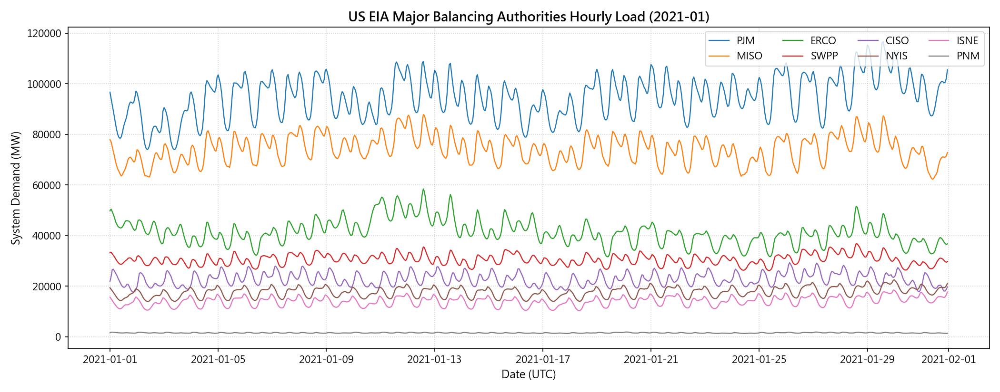
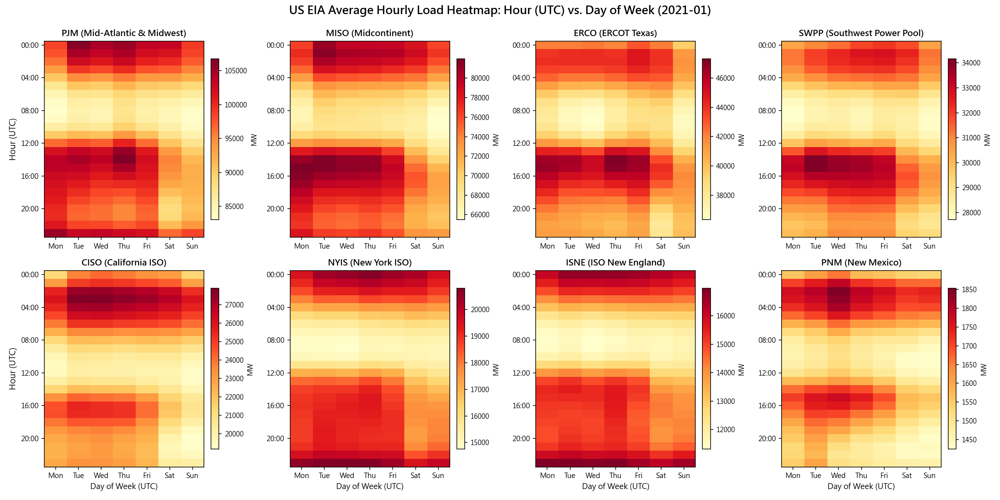
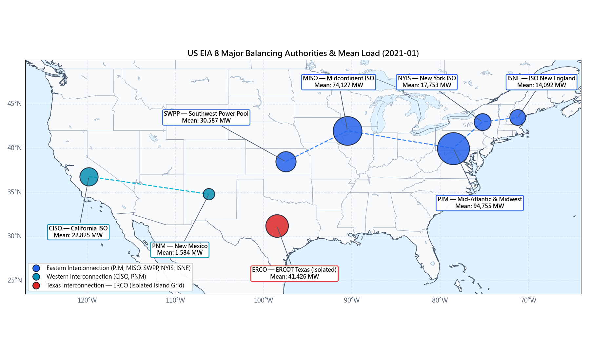

# LoadPulse 美國聯邦 EIA 資料品質檢核報告

## 1. 資料來源與定義摘要
- **資料來源**：美國聯邦能源資訊署 Form EIA-930 (`region-sub-ba-data` 端點，涵蓋全美 8 大一級電網調度區、共 82 個次平衡調度區)
- **原始檔案**：`data/raw/US_EIA_Demand/US_EIA_SubBA_RAW_202101.csv`（共 `61,090` 筆原始明細，保留原始下載狀態，未經覆寫）
- **負載定義**：採用次平衡調度區（Sub-BA）之 `value` 欄位（淨發電量加計跨區淨受電量），並依主要電網調度區（`parent` BA：`CISO`、`ERCO`、`ISNE`、`MISO`、`NYIS`、`PJM`、`PNM`、`SWPP`）逐時彙總為系統總負載（不含表後屋頂太陽能自發自用）。
- **單位與聚合方式**：原始資料為逐小時累積電能（`MWh`），在 1 小時解析度下數值直接等同於平均有功功率（`MW`）。
- **時間涵蓋範圍**：`2021-01-01T00:00:00Z` 至 `2021-01-31T23:00:00Z`（共 31 天，744 小時；原始 API 抓取含 `2021-02-01T00:00:00Z` 邊界點，經標準網格對齊為完整 744 小時）。
- **時區與資料表結構**：由於全美跨越美東、美中、山區與太平洋多個時區，統一以 **UTC** 作為基準時間軸（`timestamp_utc` 作為唯一主鍵），橫向整合 8 大調度區。
- **輸出檔案**：
  - 標準寬表：`data/processed/US_EIA_ALL_hourly_202101.csv`（744 筆、20 欄，含共用日曆特徵與 8 大調度區負載／品質旗標）
  - 完整稽核寬表：`data/processed/US_EIA_ALL_hourly_202101_full_qc.csv`

---

## 2. 清洗前後筆數與各調度區品質檢核統計

### 2.1 八大一級調度區清洗與異常旗標總表

| 調度區代碼 | 電網涵蓋區域 | 次區數 (`subba`) | 清洗前筆數 | 清洗後筆數 (1h) | 缺失時數 (`is_missing`) | 重複時間 (`is_duplicate`) | 可疑極端值 (`is_suspected_outlier`) |
| :--- | :--- | :---: | :---: | :---: | :---: | :---: | :---: |
| **PJM** | 美東與中大西洋互聯電網 | `20` | `14,900` | `744` | `0` (`0.00%`) | `0` | `0` 筆 (`0.00%`) |
| **MISO** | 美國中西部獨立系統調度中心 | `6` | `4,470` | `744` | `0` (`0.00%`) | `0` | `0` 筆 (`0.00%`) |
| **ERCO** | 德州獨立電網 (ERCOT) | `8` | `5,960` | `744` | `0` (`0.00%`) | `0` | `25` 筆 (`3.36%`) |
| **SWPP** | 西南電力池 (Southwest Power Pool) | `17` | `12,665` | `744` | `0` (`0.00%`) | `0` | `2` 筆 (`0.27%`) |
| **CISO** | 加州獨立系統調度中心 | `4` | `2,980` | `744` | `0` (`0.00%`) | `0` | `0` 筆 (`0.00%`) |
| **NYIS** | 紐約州獨立系統調度中心 | `11` | `8,195` | `744` | `0` (`0.00%`) | `0` | `0` 筆 (`0.00%`) |
| **ISNE** | 新英格蘭獨立系統調度中心 | `8` | `5,960` | `744` | `0` (`0.00%`) | `0` | `0` 筆 (`0.00%`) |
| **PNM** | 新墨西哥州公共服務公司 | `8` | `5,960` | `744` | `0` (`0.00%`) | `0` | `0` 筆 (`0.00%`) |

### 2.2 各調度區負載數值分佈與統計區間摘要 (MW)

| 調度區代碼 | 最小值 (MW) | 平均值 (MW) | 最大值 (MW) | IQR 正常統計區間 (MW) | 異常值成因判讀 |
| :--- | :---: | :---: | :---: | :---: | :--- |
| **PJM** | `74,034.00` | `94,754.94` | `116,651.00` | `[70171.0, 119237.0]` | 跨州大型聯網負載基數龐大，波動平穩無離群值 |
| **MISO** | `62,273.00` | `74,127.12` | `87,823.00` | `[57909.0, 90303.0]` | 冬季取暖需求穩定，全月落於正常統計區間 |
| **ERCO** | `31,664.00` | `41,426.46` | `58,455.00` | `[30676.6, 52161.6]` | 德州受冬季冷鋒侵襲，電暖器負載驟升觸發高負載尖峰 |
| **SWPP** | `26,187.00` | `30,586.74` | `36,809.00` | `[24686.5, 36378.5]` | 鄰近德州受同一波低溫氣團影響，出現 2 筆寒流尖峰 |
| **CISO** | `17,657.00` | `22,825.22` | `29,308.00` | `[14380.8, 31044.8]` | 冬季太陽光電影響較夏季溫和，全月無離群值 |
| **NYIS** | `14,025.00` | `17,752.55` | `22,495.00` | `[11503.4, 23798.4]` | 都會區日夜節律穩定，全月無離群值 |
| **ISNE** | `10,418.00` | `14,092.14` | `18,505.00` | `[8227.2, 19841.2]` | 冬季取暖負載平穩，全月無離群值 |
| **PNM** | `1,336.00` | `1,584.37` | `1,930.00` | `[1180.5, 1984.5]` | 區域規模較小且分布集中，全月無離群值 |

### 2.3 可疑極端值（Outlier）判定規則與物理保留原則
1. **雙重判定規則（`core_pipeline.py`）**：
   - **物理合理硬邊界**：考量大型跨州聯網（如 `PJM`、`MISO` 尖峰逾 `100,000 MW`），設定有效範圍為 `100.0 MW` 至 `200,000.0 MW`，用以排除負值、全網歸零或量測突波。
   - **統計四分位距法（1.5 × IQR 法則）**：針對各調度區計算第 25 百分位數（$Q_1$）與第 75 百分位數（$Q_3$），令 $\text{IQR} = Q_3 - Q_1$，定義正常統計區間為 $[\max(100,\; Q_1 - 1.5 \times \text{IQR}),\; \min(200000,\; Q_3 + 1.5 \times \text{IQR})]$（標準常態分布下約涵蓋 99.3% 之觀測值），落於區間外者標記為 `is_suspected_outlier = 1`。
2. **只標記、不刪除原則**：`ERCO` 與 `SWPP` 標記出之離群值皆為冬季寒流引發之真實取暖負載尖峰，依規範完整保留原數值，僅透過 `*_quality_flag` 提供模型訓練參考。

---

## 3. 視覺化品質檢核

### 3.1 2021 年 1 月八大調度區逐小時負載曲線
下圖呈現美國八大調度區於 2021 年 1 月之系統負載規模層級（`PJM` 與 `MISO` 居首，`ERCO` 於中旬及下旬呈現明顯寒流尖峰波動）：

### 3.2 小時 (UTC) × 星期幾平均負載熱圖
下圖以統一 **UTC** 時間軸呈現八大調度區各時段之平均負載分布（各子圖依自身規模獨立配置色階；美東至美西當地時間約為 `UTC-5` 至 `UTC-8`，故當地傍晚用電尖峰對應圖中 `00:00–04:00 UTC`，而 `CISO` 加州當地正午太陽能淨負載凹陷則對應 `18:00–22:00 UTC`）：

### 3.3 八大一級調度區空間地理位置與平均負載分布
下圖呈現 Form EIA-930 `region-sub-ba-data` 所涵蓋之 8 大一級電力調度機構（彙總全美 82 個次平衡區，約佔全美 65%–70% 總用電量）之相對地理位置、聯網群組（東部聯網、西部聯網與德州孤島電網 `ERCO`）與平均負載規模：

---

## 4. 檢核結論與三國管線整合總結
1. **三國資料工程全面到位**：至此已完成 **丹麥 Energinet**、**澳洲 AEMO（NEM 五大調度區寬表）** 與 **美國聯邦 EIA（八大調度區寬表）** 之全自動化擷取、標準化清洗、品質檢核與視覺化報告。
2. **跨國建模支援性**：所有輸出資料集皆以 `timestamp_utc` 為唯一主鍵、統一轉換為 `MW` 功率單位，並保留完整品質旗標，可直接支援後續單區預測與跨國遷移學習實驗。