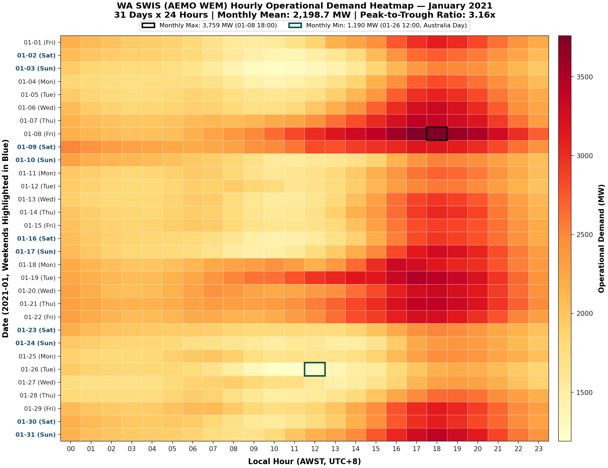
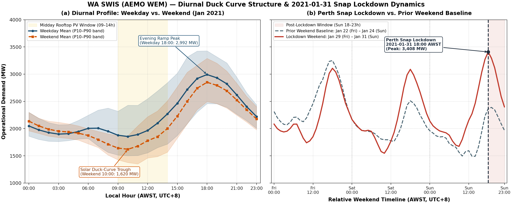

# 西澳電力市場（AEMO WEM / SWIS）2021 年 1 月單月 Pilot 資料管線報告

> **專案模組**：`wa_wem_pilot`（完全獨立 Pilot 驗證管線）  
> **目標區域**：`WA_SWIS`（澳洲西澳西南互聯系統 South West Interconnected System）  
> **資料區間**：`2021-01-01 00:00 AWST` 至 `2021-01-31 23:00 AWST`（共 `744` 小時）  
> **產出檔案**：`wa_wem_pilot/data/processed/AU_AEMO_WEM_hourly_2021_01.parquet`（23.9 KB）

---

## 1. 資料來源與獲取便利度評級

### 1.1 官方公開入口與獲取便利度評級（T0）

西澳批發電力市場（Wholesale Electricity Market, **WEM**）由澳洲能源市場運營中心（**AEMO**）負責調度與資料公開，其服務範圍為西澳西南互聯系統（South West Interconnected System, **SWIS**，涵蓋伯斯都會區與西澳西南部）。AEMO WA 透過公開靜態檔案伺服器 `https://data.wa.aemo.com.au/public/public-data/datafiles/` 提供年度歷史 CSV 檔案。

| 評估構面 | 評核結果 |
| :--- | :--- |
| **資料來源機構** | Australian Energy Market Operator（AEMO — WA WEM / SWIS） |
| **獲取便利度評級** | **T0（最高等級：公開直連下載）** |
| **認證與金鑰需求** | 免註冊、免登入、免 API Key、無 OAuth Token 過期與速率額度限制 |
| **原始時間解析度** | 30 分鐘（Interval-Beginning，每日 48 個交易區間） |
| **原始檔案格式** | UTF-8 CSV（單年度約 0.8 MB，輕量易重現） |
| **重複執行冪等性** | 支援 HTTP 重試與原子暫存檔覆寫（`fetch.py`） |

### 1.2 實測可用端點與交易日跨年邊界說明

本 Pilot 實測探勘 AEMO WA 公開目錄，確認下列 CSV 端點皆可免認證直接以 `HTTP 200` 下載：

- **主要採用端點（SWIS 官方運轉負載 Operational Demand）**：
  - 2021 年度檔（780.0 KB）：`https://data.wa.aemo.com.au/public/public-data/datafiles/operational-demand/operational-demand-2021.csv`
  - 2020 年度檔（782.2 KB，補齊跨年交易日邊界）：`https://data.wa.aemo.com.au/public/public-data/datafiles/operational-demand/operational-demand-2020.csv`
- **同入口已驗證可用輔助端點（未混入本負載清洗，供後續擴充發電結構與電價研究參考）**：
  - 平衡市場摘要（含發電與結算電價）：`https://data.wa.aemo.com.au/public/public-data/datafiles/balancing-summary/balancing-summary-2021.csv`
  - 負載與計量發電摘要：`https://data.wa.aemo.com.au/public/public-data/datafiles/load-summary/load-summary-2021.csv`

> **關鍵工程發現 — WEM 交易日（Trading Day）邊界**：  
> WEM 市場規定每個「交易日」自當地時間 **`08:00 AWST`** 起算至次日 **`08:00 AWST`**（區間編號 `1` 至 `48`）。因此，西曆 **`2021-01-01 00:00:00` 至 `07:30:00 AWST`**（共 `16` 筆 30 分鐘紀錄）在官方分類中隸屬交易日 `2020-12-31`（區間編號 `33–48`），存放在 `operational-demand-2020.csv` 檔尾；而 `2021-01-01 08:00:00` 至 `2021-01-31 23:30:00 AWST`（共 `1,472` 筆）則位於 `operational-demand-2021.csv`。`fetch.py` 同時拉取兩檔並原樣切出 `2021-01` 全月共 **`1,488` 筆** 30 分鐘原始資料，徹底消除跨年 8 小時斷層。

---

## 2. 原始資料欄位字典（Word 友善防破版雙格式）

以下針對 `wa_wem_pilot/data/raw/operational-demand-2021-01.csv` 忠實保留之原始 5 欄位，提供 **精簡四欄 Markdown 表格** 與 **Tab 分隔純文字區塊** 雙格式，方便直接檢閱或貼入 Microsoft Word 排版不破版。

### 2.1 精簡四欄 Markdown 表格

| 欄位名稱 | 型別 | 說明 | 範例值 |
| :--- | :--- | :--- | :--- |
| `Trading Date` | string (YYYY-MM-DD) | WEM 交易日（當日 08:00 至次日 08:00 AWST） | `2020-12-31` |
| `Interval Number` | int (1–48) | 交易日內第 N 個 30 分鐘區間（1=08:00，33=次日 00:00） | `33` |
| `Trading Interval` | datetime (AWST) | 30 分鐘區間起始時間（Interval-Beginning，固定 UTC+8） | `2021-01-01 00:00:00` |
| `Operational Demand (MW)` | float64 | SWIS 系統運轉負載均值（MW，已扣除表後屋頂太陽能） | `2167.948` |
| `Extracted At` | datetime (AWST) | AEMO 資料庫批次匯出時間戳（年度檔僅首筆填值） | `2022-01-01 12:00:07` |

### 2.2 可直接貼入 Word 轉表格之 Tab 分隔純文字區塊

> **Word 轉換步驟**：全選複製下方區塊文字 → 貼入 Word → 全選貼上內容 → 點選「插入」→「表格」→「文字轉換為表格」→ 分隔文字選擇「定位點（Tab）」即可生成整齊四欄表格。

```tsv
欄位名稱	型別	說明	範例值
Trading Date	string (YYYY-MM-DD)	WEM 交易日（當日 08:00 至次日 08:00 AWST）	2020-12-31
Interval Number	int (1–48)	交易日內第 N 個 30 分鐘區間（1=08:00，33=次日 00:00）	33
Trading Interval	datetime (AWST)	30 分鐘區間起始時間（Interval-Beginning，固定 UTC+8）	2021-01-01 00:00:00
Operational Demand (MW)	float64	SWIS 系統運轉負載均值（MW，已扣除表後屋頂太陽能）	2167.948
Extracted At	datetime (AWST)	AEMO 資料庫批次匯出時間戳（年度檔僅首筆填值）	2022-01-01 12:00:07
```

---

## 3. 清洗規格與 2021 年 1 月實證統計摘要

### 3.1 時區對齊、聚合規則與輸出規格

| 處理項目 | 規格與驗證結果 |
| :--- | :--- |
| **當地時區** | `Australia/Perth`（AWST，固定 `UTC+8`，自 2009 年起全年**無夏令時間 DST**） |
| **當地時間範圍** | `2021-01-01 00:00 AWST` 至 `2021-01-31 23:00 AWST` |
| **對應 UTC 範圍** | `2020-12-31 16:00 UTC` 至 `2021-01-31 15:00 UTC` |
| **時間對齊方式** | Interval-Beginning 對齊：將每小時 `HH:00` 與 `HH:30` 兩筆 30 分鐘平均功率取算術平均，產出標準逐小時負載均值 `load_mw`（MW） |
| **輸出檔案路徑** | `wa_wem_pilot/data/processed/AU_AEMO_WEM_hourly_2021_01.parquet` |
| **輸出標準欄位（10 欄）** | `region_id`, `timestamp_utc`, `local_datetime`, `local_date`, `local_hour`, `day_of_week`, `is_weekend`, `load_mw`, `is_missing`, `quality_flag` |

### 3.2 744 小時完整性檢核結果

- **原始 30 分鐘紀錄數**：`1,488` 筆（`16` 筆來自 2020 檔跨年交易日 + `1,472` 筆來自 2021 檔），原始重複時間戳 `0` 筆、原始空值 `0` 筆。
- **逐小時序列完整性**：理論小時數 `744` 小時、實際產出 **`744` 小時**；其中每小時皆具 2/2 完整半小時區間者共 **`744` 小時（100.0%）**，缺值數 **`0`**，半缺區間 `0` 筆，非正值異常 `0` 筆，`quality_flag="OK"` 達 **`744/744`（100.0%）**。

### 3.3 全月關鍵實證統計表（2021-01 逐小時序列）

| 統計指標 | 實證數值 | 備註／時間點 |
| :--- | :---: | :--- |
| 總小時數（Total Hours） | `744` | 31 天 × 24 小時完整無缺口 |
| 缺值數（Missing Hours） | `0` | `is_missing=False` 達 100.0% |
| 全月均值（Mean） | `2,198.70 MW` | — |
| 全月標準差（Std Dev） | `500.79 MW` | 變異係數 CV = `22.78%` |
| 中位數（Median） | `2,086.58 MW` | 四分位距 IQR = `643.30 MW`（P25=`1,838.02` / P75=`2,481.31`） |
| 第 5 / 第 95 百分位（P5 / P95） | `1,543.30` / `3,172.68 MW` | — |
| 全月最小值（正午太陽能谷值） | **`1,189.94 MW`** | `2021-01-26 12:00 AWST`（原始 30m 最低 `1,177.87 MW` @ `2021-01-26 11:30:00`） |
| 全月最大值（盛夏傍晚尖峰） | **`3,759.28 MW`** | `2021-01-08 18:00 AWST`（原始 30m 最高 `3,787.80 MW` @ `2021-01-08 18:00:00`） |
| 全月尖離峰倍數（Max / Min） | `3.16x` | 峰谷落差達 `2,569.34 MW` |
| 平日均值（Weekday, 21 天） | `2,238.01 MW` | 週一至週五 |
| 週末均值（Weekend, 10 天） | `2,116.16 MW` | 週六至週日 |
| 平日 vs. 週末負載差 | **`+121.85 MW`** | 平日較週末高 `+5.76%` |
| 平均日內夜間谷值（00–05 時） | `1,915.62 MW` | 發生於平均 `03:00 AWST` |
| 平均日內正午太陽能谷值（09–14 時） | **`1,779.06 MW`** | 發生於平均 `10:00 AWST`（低於凌晨谷值 `-136.56 MW`） |
| 平均日內傍晚尖峰（16–22 時） | `2,946.31 MW` | 發生於平均 `18:00 AWST` |
| 平均鴨子曲線爬坡幅度 | **`+1,167.26 MW`** | `10:00→18:00`（8 小時內激增 `+65.6%`；單小時最陡爬坡 `15:00→16:00` 達 `+258.79 MW/h`） |



*圖 1：西澳電力市場（WA SWIS）2021 年 1 月 31 日 × 24 小時（AWST, UTC+8）逐時運轉負載熱力圖。深紅區塊集中於 17:00–19:00 傍晚盛夏空調尖峰（全月最高 01-08 18:00 達 `3,759.28 MW`），上午 09:00–13:00 呈明顯淺色太陽能凹陷帶，並可見週末降載條紋與 01-26 澳洲國慶日正午全月最低谷值（`1,189.94 MW`）。*

### 3.4 異常、尖峰與重大事件實證觀察

#### (1) 盛夏高溫熱浪尖峰（Top 5 單日尖峰）

2021 年 1 月正值南半球盛夏，伯斯多次受內陸乾熱氣團影響，系統尖峰集中於傍晚 `17:00–18:00 AWST`（太陽能發電急降與下班返家空調開啟疊加）。全月最高逐小時負載出現在 **`2021-01-08 18:00 AWST`（`3,759.28 MW`）**：

| 排名 | 日期 | 星期 | 尖峰時段（AWST） | 逐小時均值負載（MW） |
| :---: | :---: | :---: | :---: | :---: |
| 1 | 2021-01-08 | 週五 | 18:00 | 3,759.28 |
| 2 | 2021-01-19 | 週二 | 17:00 | 3,504.69 |
| 3 | 2021-01-21 | 週四 | 18:00 | 3,427.35 |
| 4 | 2021-01-07 | 週四 | 17:00 | 3,423.45 |
| 5 | 2021-01-31 | 週日 | 18:00 | 3,407.54 |

#### (2) 澳洲國慶日與正午屋頂太陽能深谷（鴨子曲線效應）

全月最低運轉負載落於 **`2021-01-26 12:00 AWST`（`1,189.94 MW`）**，當日為 **澳洲國慶日（Australia Day）** 國定假日：商辦與工業基載下降，疊加晴朗正午高強度表後屋頂太陽能自發自用與餘電倒送，將系統淨負載壓低至不足全月尖峰的三分之一（峰谷比 `3.16x`）。即便就全月 31 日平均日型觀察，上午 `10:00 AWST` 均載（`1,779.06 MW`）亦明顯低於凌晨 `03:00` 基載谷值（`1,915.62 MW`），呈現典型深腹鴨子曲線。

#### (3) `2021-01-31 18:00 AWST` 伯斯突發 COVID-19 封城前後負載變化

西澳政府於 2021 年 1 月 31 日（週日）午後緊急宣布伯斯都會區、皮爾區與西南部自當日 **`18:00 AWST`** 起實施為期 5 天的嚴格封城（Snap Lockdown）。當日同時遭遇盛夏高溫，單日尖峰於 `18:00 AWST` 達 `3,407.54 MW`（全月第 5 高）。為排除單純日落爬坡與週日週期效應，本研究除比較當日封城前（12:00–17:00）與封城後（18:00–23:00）外，另以同月前四個週日（2021-01-03、2021-01-10、2021-01-17、2021-01-24）同區段作為對照基準進行**差異中差異（Difference-in-Differences, DiD）**檢定：

- **封城前 6 小時（12:00–17:00 AWST）**：1/31 均值 `2,656.79 MW` vs. 前四週日均值 `1,944.24 MW`，受當日高溫空調與民眾返家備貨影響，超額負載達 **`+712.54 MW`（`+36.65%`）**。
- **封城後 6 小時（18:00–23:00 AWST）**：1/31 均值 `2,942.16 MW` vs. 前四週日均值 `2,434.04 MW`（當日因正常傍晚爬坡較午後增 `+285.38 MW`，低於前四週日正常傍晚增幅 `+489.80 MW`），超額負載顯著收斂至 **`+508.12 MW`（`+20.88%`）**。
- **淨封城衝擊（DiD 估計值）**：`18:00` 封城生效後，相較前四週日之超額負載淨縮窄 **`-204.42 MW`**。逐小時追蹤可見，超額負載自 `18:00` 生效瞬間（`+735.23 MW`）起一路單調回落至 `23:00`（`+314.43 MW`），清晰反映餐飲、零售、娛樂等商業用電於 18:00 強制關閉後之即時負載消退特徵。

| 時段（AWST） | 階段 | 2021-01-31（MW） | 前四週日均值（MW） | 差值（MW） | 相對幅度 |
| :---: | :---: | :---: | :---: | :---: | :---: |
| 15:00 | 封城生效前 | 2,746.05 | 1,965.63 | +780.42 | +39.70% |
| 16:00 | 封城生效前 | 3,033.91 | 2,253.03 | +780.88 | +34.66% |
| 17:00 | 封城生效前 | 3,271.66 | 2,528.53 | +743.13 | +29.39% |
| 18:00 | 封城生效後 | 3,407.54 | 2,672.31 | +735.23 | +27.51% |
| 19:00 | 封城生效後 | 3,292.59 | 2,643.46 | +649.13 | +24.56% |
| 20:00 | 封城生效後 | 3,115.53 | 2,567.10 | +548.43 | +21.36% |
| 21:00 | 封城生效後 | 2,852.99 | 2,401.43 | +451.56 | +18.80% |
| 22:00 | 封城生效後 | 2,585.75 | 2,235.79 | +349.97 | +15.65% |
| 23:00 | 封城生效後 | 2,398.57 | 2,084.15 | +314.43 | +15.09% |



*圖 2：WA SWIS 日內負載型態與突發封城對照雙子圖。左圖為 2021 年 1 月平日與週末 24 小時平均負載曲線及 P10–P90 分位數區間，清晰呈現屋頂太陽能造成之正午淨負載深谷（平均 10:00 降至 `1,779.06 MW`）與日落傍晚急爬坡；右圖比較封城週末（01-29 至 01-31）與前一完整週末基準（01-22 至 01-24），可見 `2021-01-31 18:00 AWST` 伯斯突發封城生效後，當日晚間負載自高溫尖峰迅速向基準線收斂。*

---

## 4. 電網同質性對標分析（WA SWIS vs. NEM 東岸電網／台灣獨立電網）

為評估本資料集納入跨電網獨立測試（Cross-Grid Pilot）之研究價值，下表從電網拓撲、再生能源滲透與氣候驅動負載三個核心維度，將 **WA SWIS** 與 **澳洲東岸 NEM** 及 **台灣獨立電網（台電系統）** 進行系統性對標：

| 對標維度 | 西澳 WA SWIS（本 Pilot） | 澳洲東岸 NEM（NSW/VIC/QLD/SA/TAS） | 台灣獨立電網（Taipower） |
| :--- | :--- | :--- | :--- |
| **電網拓撲與互聯性** | **完全獨立孤島電網**（無任何跨區互聯線，系統容量 ~1.2–4.0 GW） | 5 州跨區互聯電網（長距離交流／直流聯網，可跨州調度轉供） | **完全獨立海島電網**（無跨國互聯線，需 100% 自主平衡頻率與備轉） |
| **時區與夏令時間** | 固定 `UTC+8`（**無 DST**，與台灣完全同區） | 跨 UTC+9.5/+10/+11，且多州實施 DST（跨區時差複雜） | 固定 `UTC+8`（**無 DST**） |
| **表後太陽能與鴨子曲線** | 全球最高滲透率族群之一；正午淨負載谷值已低於凌晨基載，傍晚急爬坡顯著 | 南澳（SA）極端鴨子曲線，其餘各州程度不一且具跨區平滑效應 | 近年太陽光電快速併網，正午淨負載凹陷與 16:00–19:00 傍晚爬坡日趨顯著 |
| **夏季氣候與空調尖峰** | 南半球**地中海型乾熱氣候**（1 月盛夏熱浪；單峰集中於 17:00–19:00 傍晚） | 跨溫帶海洋至亞熱帶多氣候帶，區域尖峰具時間錯峰效果 | 北半球**亞熱帶濕熱氣候**（7–8 月盛夏；午後商辦＋晚間住宅空調負荷高） |
| **資料獲取與基準適用性** | **T0 免金鑰公開 CSV**，結構精簡、零缺值 | T0 公開但檔案分散（5 區域 ZIP/CSV 拆檔，前處理成本較高） | 公開逐時資料解析度與歷史回溯長度受限 |

### 三大維度研究價值評估

1. **獨立孤島電網架構（與台灣高度同構，優於跨州互聯之 NEM）**  
   不同於 NEM 東岸五州可透過跨州互聯線分散區域極端負載與備轉壓力，SWIS 是全球最具代表性的大型獨立孤島電網之一，所有頻率調節、尖峰爬坡與極端事件衝擊（如突發封城或熱浪）皆直接反映在單一系統總運轉負載中，且不被外部轉供雜訊稀釋。此結構特性與台灣獨立海島電網高度一致，且兩地同屬固定 `UTC+8`（無夏令時間切換造成的 23/25 小時日異常），在時間對齊與系統邊界條件上具高度可比性。

2. **高比例屋頂太陽能鴨子曲線效應（前瞻壓力測試場域）**  
   2021-01 實證已證明 SWIS 在正午 `10:00` 出現低於凌晨基載的深谷，並於 `8` 小時內產生平均 `+1,167.26 MW`（`+65.6%`）的劇烈傍晚淨負載爬坡，且在國定假日（1/26）更下探 `1,189.94 MW`。相較於台灣正處於高光電滲透轉型期，SWIS 可作為「高滲透率鴨子曲線之先行實證場景」，用來嚴格檢驗預測模型對**正午谷值下探**、**日落斜率轉折**以及**假日×高光電疊加效應**的泛化能力。

3. **地中海型氣候夏季空調負載（跨半球季節反轉之 Out-of-Distribution 驗證價值）**  
   WA SWIS 的盛夏空調尖峰出現在南半球 1 月（對應北半球冬季），並以高溫乾熱、午後海風調節與傍晚單峰為特徵；這使本資料集成為檢驗模型「是否過度記憶北半球月份先驗（Calendar Overfitting）」的理想獨立測試集。結合本 Pilot 驗證完成的 `T0` 免認證自動化抓取與 `744` 小時零缺值標準化 Parquet 管線，後續可無痛擴展至多年份（如 2019–2024）以支援長期跨電網遷移學習與極端事件（熱浪、突發封城）韌性評估。
